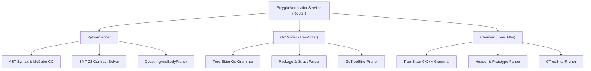

# 📐 Polyglot Code Verification Specification & Architecture Guide

## 1. Executive Summary
The **Polyglot Code Verification Subsystem** in Vazus SuperGraph OS provides unified, multi-language static analysis, symbol extraction, AST pruning, and code health scoring across **Python**, **Golang**, and **C/C++**.

Grounding sources: *CodeScene CodeHealth Research (2026)*, *Tree-Sitter Multi-Language Grammar Engine*, *Z3 SMT Formal Logic Proofs*, and *ICSE/FSE 2026 Patchwork Invariant Testing*.

---

## 2. Architectural Topology



---

## 3. Supported Languages & Capabilities Matrix

| Capability | Python (`.py`, `.pyi`) | Golang (`.go`) | C / C++ (`.c`, `.cpp`, `.h`, `.hpp`) |
|:---|:---:|:---:|:---:|
| **Parser Backend** | Native `ast` + SMT Z3 | Tree-Sitter (`tree_sitter_go`) | Tree-Sitter (`tree_sitter_c`) |
| **AST Pruning (>75% Token Savings)** | `DocstringAndBodyPruner` | `GoTreeSitterPruner` | `CTreeSitterPruner` |
| **Skeleton Placeholder** | `...` (Ellipsis) | `panic("skeleton")` | `/* ... */` |
| **Code Health Metric** | Scaled 0.0 – 10.0 (Target $\ge 9.5$) | Scaled 0.0 – 10.0 | Scaled 0.0 – 10.0 |
| **Complexity Metric** | McCabe Cyclomatic Complexity ($CC \le 10$) | Branch Count ($CC \le 15$) | Branch Count ($CC \le 20$) |
| **Formal Logic Proofs** | Hoare Contracts $\{P\} C \{Q\}$ via Z3 | Type System & Signature Validation | Prototype Matching & AST Validity |

---

## 4. Code Health Scoring Formulation
Following SOTA benchmarks (Adam Tornhill et al., CodeScene 2026), AI agents require healthy code ($\text{Health} \ge 9.5$) to prevent hallucination cascades:

$$\text{HealthScore} = 10.0 - \Delta_{\text{Complexity}} - \Delta_{\text{Volume}} - \Delta_{\text{Syntax}}$$

Where:
$$\Delta_{\text{Complexity}} = \min(4.0, (CC - \text{Threshold}) \times \alpha)$$
$$\Delta_{\text{Volume}} = \min(2.0, (\text{LOC} - \text{MaxLOC}) \times \beta)$$
$$\Delta_{\text{Syntax}} = 5.0 \quad \text{if syntax errors detected}$$

---

## 5. Usage & API Reference

```python
from vazus_core.verification.polyglot_verifier import get_polyglot_verification_service

service = get_polyglot_verification_service()

# 1. Single file evaluation
result = service.verify_file("path/to/module.go")
print(f"Passed: {result.passed}, Score: {result.metrics.code_health_score}/10")

# 2. Batch polyglot evaluation
batch_results = service.verify_batch(["mod.py", "server.go", "native.c"])
for res in batch_results:
    print(f"[{res.language.upper()}] {res.file_path}: {res.metrics.token_reduction_pct}% reduction")
```
