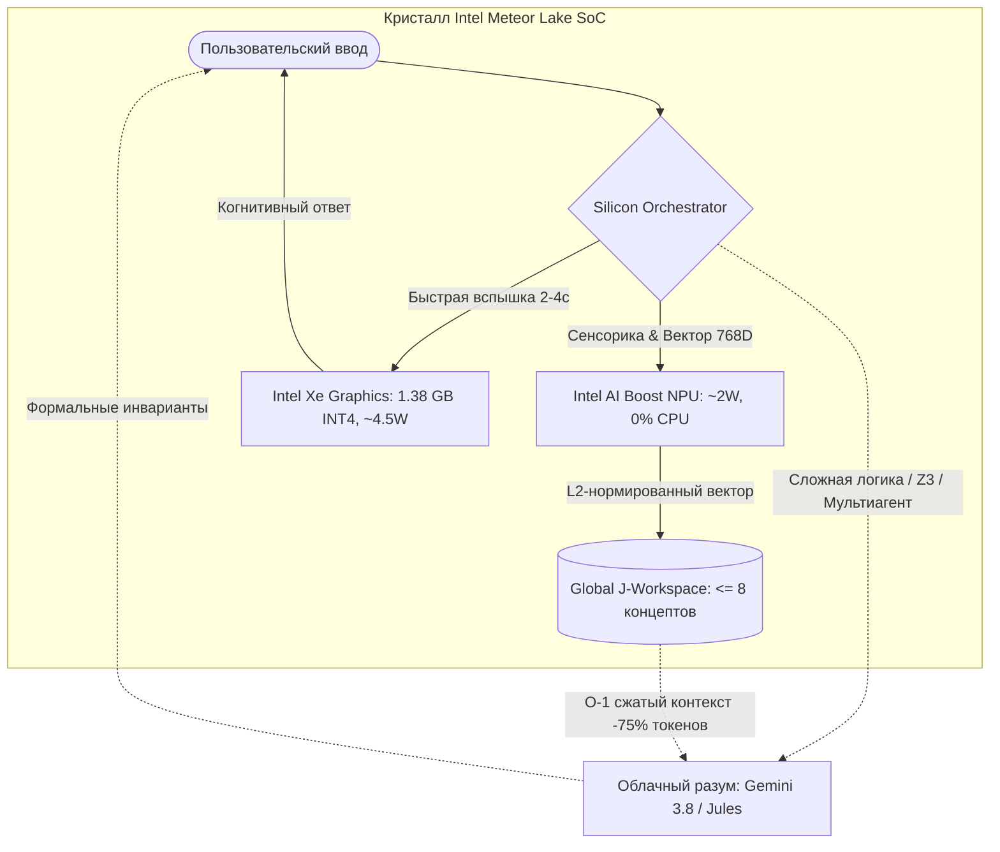

# 🏛️ Архитектурный манифест: Трехуровневый кремниевый гибрид Vazus OS v5.0

## 1. Философия и Первые Принципы (First Principles)
Архитектура спроектирована на основе строгого отказа от суррогатных маркетинговых иллюзий и подчинена двум законам:
1. **Закон физической термодинамики (Race-to-Sleep):** Минимизация расхода джоулей батареи на один полезный когнитивный ответ.
2. **Когнитивная теория глобального рабочего пространства (Global Workspace Theory / Деан, Баарс):** Сознание системы — это узкий шлюз ($\le 8$ концептов), а не бесконечный хаос неструктурированных токенов.

---

## 2. Разделение обязанностей кремния (Silicon Allocation)

### 🟢 Уровень 1: Сенсорная и Семантическая память (Tier 1 — NPU)
* **Кремний:** `Intel(R) AI Boost` (NPU 3720, VPUX Level0).
* **Модель:** `openvino_text_embeddings_model.xml` (768D).
* **Формат:** Фиксированный статический шейп `[1, 64]`.
* **Энергопотребление:** $\approx 2$ Вт.
* **Нагрузка на CPU:** **0.0%**.
* **Роль:** Мгновенно вычисляет семантические проекции входящих мыслей и заметок, выталкивая в шину `GlobalJWorkspace` ключевые концепты с весом внимания (*salience*).

### ⚡ Уровень 2: Когнитивная вспышка (Tier 2 — Xe GPU)
* **Кремний:** `Intel(R) Graphics` (Xe-LPG, 4 Xe-ядра, аппаратный INT4).
* **Модель:** `Gemma 4 E2B IT` (`openvino_language_model.bin`, 1.38 ГБ).
* **Формат:** INT4 (квантование весов через OpenVINO).
* **Энергопотребление:** $\approx 4.5$ Вт во время генерации (импульс 2–3 сек), **0 Вт в покое**.
* **Нагрузка на CPU:** $\le \mathbf{0.5\%}$.
* **Роль:** Быстрый диалог, структурирование заметок, утренний маяк, локальная помощь без интернета.

### 🌐 Уровень 3: Глубокий синтез и верификация (Tier 3 — Cloud)
* **Стек:** Google Gemini 3.8 Flash / Google Jules / SMT Z3 / Concordia Multi-Agent Jury ($\ge 66\%$).
* **Роль:** Рефакторинг репозитория, математические доказательства, поиск по 500 источникам в NotebookLM.
* **Связь с локальным контуром:** Промпты сжимаются срезом памяти из J-Space, экономя до 75% токенов и устраняя «галлюцинации».

---

## 3. Точки входа и запуск

| Интерфейс | Команда | Назначение |
|---|---|---|
| **Терминальный REPL** | `python C:\vazus\scripts\chat_gemma4_npu.py` | Прямой интерактивный диалог с живой телеметрией NPU + GPU |
| **Утренний маяк** | Запускается сам из автозагрузки Windows | Фокус дня и фиксация побед в `daily/YYYY-MM-DD.md` |
| **Веб-интерфейс** | Открыть `C:\vazus\chat_gemma.html` | Графический оффлайн-чат с переключателем моделей |
