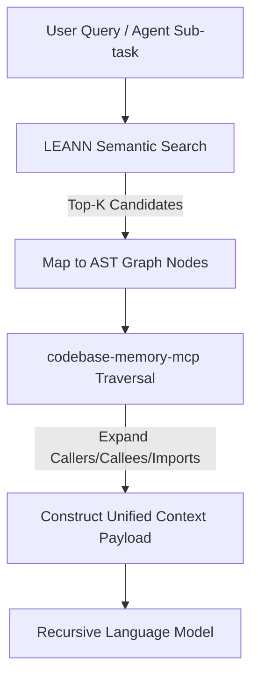

# Optimizing Hybrid Code Search: Integrating AST Graphs, Vector Databases, and Recursive Language Models

## Introduction
Modern software development involves large codebases with complex, multi-layered dependencies. When building autonomous coding agents or Retrieval-Augmented Generation (RAG) tools, traditional keyword search (such as BM25) and simple dense vector search struggle when used in isolation. Keyword search fails to capture semantic intent, while pure vector search is blind to the structural architecture of the code, often resulting in "context rot" or hallucinated dependencies. 

To overcome these challenges, a hybrid code search architecture combines Abstract Syntax Tree (AST) structural graphs (implemented via tools like `codebase-memory-mcp`) and storage-efficient semantic vector databases (such as `LEANN`) with lazy recomputation. When integrated with Recursive Language Models (RLMs), this hybrid indexing paradigm provides reasoning agents with the precise structural and semantic context necessary to perform complex code navigation, self-healing execution, and automated refactoring.

---

## AST-Based Structural Graphs (`codebase-memory-mcp`)

### Graph Representation and Extraction
An AST-based structural graph models a codebase as a property graph, where nodes represent code elements and edges represent semantic and syntactic relationships. The extraction of this graph is typically executed using parser generators like [Tree-sitter](https://tree-sitter.github.io/tree-sitter/) [6]. 

By parsing the source files into concrete syntax trees, the indexer extracts distinct entities and maps their connections:
*   **Nodes:** Files, modules, namespaces, classes, methods, functions, variables, and type definitions.
*   **Edges:** Relationships such as `DEFINES` (e.g., a file defining a class), `CONTAINS` (a class containing a method), `CALLS` (a function invoking another function), `IMPORTS` (a module importing another package), and `INHERITS` (subclass relationships).

Unlike LLM-extracted knowledge graphs, which are prone to omission and hallucinations, AST-derived graphs are deterministic, syntactically accurate, and cheap to generate.

### Query and Contextualization Operations
Through standard communication interfaces like the [Model Context Protocol (MCP)](https://modelcontextprotocol.io) [5], reasoning models can query the AST graph using query languages such as Cypher. This enables operations that go beyond file-level search:
*   **Path Tracing (`trace_path`):** Tracing the call or import chain between two distant nodes (e.g., from an entry API handler to a database schema file).
*   **AST-Aware Chunking:** Using AST nodes to define chunk boundaries. Instead of splitting code at arbitrary character or line counts, code is chunked at method, function, or class boundaries. This ensures that every retrieved fragment is syntactically coherent and contains its corresponding declaration and documentation context.

---

## Storage-Efficient Vector Search (`LEANN`)

### Selective and Lazy Recomputation
For coding assistants running locally or on resource-constrained host machines, traditional vector databases are often impractical due to the massive storage overhead of high-dimensional embeddings. The [LEANN Research Paper](https://arxiv.org/abs/2506.08276) [2] and its [LEANN Project Repository](https://github.com/yichuan-w/LEANN) [1] introduce a low-storage vector index designed to mitigate this issue. 

LEANN reduces storage requirements by up to 97% through a combination of techniques:
*   **Graph Pruning:** Utilizing a high-degree preserving proximity graph to structure data items.
*   **Vector Compression:** Storing compressed Product Quantization (PQ) codes rather than full-dimensional dense embeddings.
*   **On-Demand (Lazy) Recomputation:** During semantic retrieval, search starts with a fast traversal of the pruned proximity graph using low-overhead PQ codes. Once a candidate subset of promising nodes is identified, the system recomputes the exact, high-dimensional dense embeddings on-the-fly for only those candidates. This trades a minor computational cost at query time for a massive reduction in static disk footprint.

### Lazy Index Maintenance and Updates
To prevent the indexing process from consuming excessive CPU cycles during code changes, the hybrid index implements lazy recomputation and incremental updates:
1.  **File Hashing:** Every source file in the project is tracked with a cryptographic hash.
2.  **Incremental Parsing:** When changes are detected, only files with modified hashes are re-parsed by Tree-sitter and re-embedded.
3.  **Graph Splice:** Only the affected sub-graphs and local neighborhood connections within the LEANN proximity index are modified, avoiding a full rebuild of the database.

---

## Designing the Hybrid Pipeline

A robust hybrid code search utilizes a two-phase retrieval workflow:

1.  **Phase 1: Semantic Search (Fuzzy Filtering):** The user's query or the agent's target sub-task is processed via a semantic query (e.g., "retrieve the authentication middleware flow"). LEANN executes a fast, storage-efficient proximity search using compressed codes and lazy recomputation to return the Top-K candidate functions or classes.
2.  **Phase 2: Structural Query (Precise Traversal):** The retrieved candidate node IDs are resolved within the `codebase-memory` AST graph. The system then automatically traverses adjacent edges to extract the wider structural context. For a given function, this includes fetching its signature, containing file, imported packages, incoming callers, and outgoing dependencies.
3.  **Unified Context Assembly:** The combined semantic matching and structural dependency list is compiled into a single context payload. This ensures that the reasoning engine receives not only the relevant code block but also the architecture surrounding it.

---

## Synergy with Recursive Language Models (RLMs)

### The RLM Execution Loop
Introduced by researchers at MIT CSAIL in the [Recursive Language Models Paper](https://arxiv.org/abs/2512.24601) [4] and implemented in the [RLM Framework Repository](https://github.com/alexzhang13/rlm) [3], RLMs represent a shift in how long-context tasks are managed. Rather than loading an entire large codebase into the model's active context window—which leads to performance degradation or "context rot"—RLMs treat the external data as an environment. 

The RLM operates within a Read-Eval-Print Loop (REPL) sandbox. It solves problems by writing and executing Python scripts that programmatically interact with the environment, decompose tasks, query tools, and recursively spawn lightweight sub-calls. The intermediate states and large datasets are kept in the REPL's variables and index structures rather than the model's prompt context.

### Enhancing Code Navigation
Providing the RLM agent with dynamic access to both LEANN and `codebase-memory-mcp` primitives within its REPL environment improves code navigation:
*   The RLM writes code to programmatically call `leann_search(query)` to locate starting entry points.
*   Once a candidate file is identified, the RLM queries the AST graph (`query_graph("MATCH (n)-[:CALLS]->(c) ...")`) to follow control flows.
*   By writing search scripts instead of requesting raw context, the agent keeps its active context window clean, enabling it to navigate large codebases without losing track of the core goal.

### Self-Healing Code Execution
During automated testing, compilation, or execution within the RLM's sandbox, runtime errors are common. A hybrid search pipeline enables self-healing code execution:
*   **Traceback Parsing:** When a script execution fails, the RLM captures the stack trace.
*   **AST Localization:** The RLM uses `codebase-memory-mcp` to trace the traceback paths, locating the exact lines, function boundaries, and class definitions where the failure occurred.
*   **Semantic Matching:** If the traceback suggests a missing dependency or an interface mismatch, the RLM calls LEANN to search for similar function signatures or variable definitions across other modules.
*   **Sandbox Testing:** The model edits the code using targeted AST replacements, re-runs the tests in the sandbox, and repeats the cycle until the code executes successfully.

### Complex Code Refactoring
Refactoring tasks, such as modifying a core utility function signature, require tracking cascading changes across multiple files. The hybrid index provides the necessary components for this task:
*   **Impact Analysis:** The RLM traverses the AST graph's dependency edges (`CALLS` and `IMPORTS`) from the target function to build a transitive closure of all dependent callers.
*   **Semantic Inspection:** The agent queries LEANN to analyze the semantic purpose of those callers, ensuring that modifying the signature does not break implicit behavioral invariants.
*   **Execution Verification:** The RLM programmatically updates the callers, compiles the project, resolves compiler/linter warnings in a self-healing loop, and runs the test suite to verify the changes.

---

## Architectural Recommendations

For organizations and developers looking to build this hybrid code search and reasoning system, the following concrete architectural practices are recommended:

1.  **Local-First Index Co-location:** Deploy the LEANN indexer and AST property graph parser as local sidecars (e.g., using lightweight SQLite database backends and ONNX-based embedding models). This guarantees offline capabilities, addresses data privacy concerns, and eliminates cloud retrieval latencies.
2.  **State-Triggered Lazy Index Updates:** Implement file-watchers that monitor the directory. On file save, compute the file hash and update only the modified sub-trees in the property graph and vector database. Do not re-index the entire project.
3.  **REPL-Level Tool Injection:** Inject search commands directly into the RLM's sandbox workspace as built-in Python primitives (e.g., exposing a pre-configured `search_index()` or `query_dependency_graph()` in the Python REPL globals). This allows the model to treat the search index as a standard library call.
4.  **Reciprocal Rank Fusion (RRF) Re-ranking:** Merge lexical search (BM25), semantic search (LEANN), and structural graph distance scores using RRF to order the context chunks before they are presented to the model.
5.  **Multi-Depth Budget Limits:** When configure the RLM framework, set strict constraints on maximum recursion depth (e.g., `max_depth=2` or `max_depth=3`) and execution timeouts. This prevents the agent from falling into infinite loops during complex recursive graph traversals or self-healing attempts.

---

## Sources
[1] LEANN Project Repository: https://github.com/yichuan-w/LEANN
[2] LEANN Research Paper: https://arxiv.org/abs/2506.08276
[3] RLM Framework Repository: https://github.com/alexzhang13/rlm
[4] Recursive Language Models Paper: https://arxiv.org/abs/2512.24601
[5] Model Context Protocol: https://modelcontextprotocol.io
[6] Tree-sitter Parser: https://tree-sitter.github.io/tree-sitter/