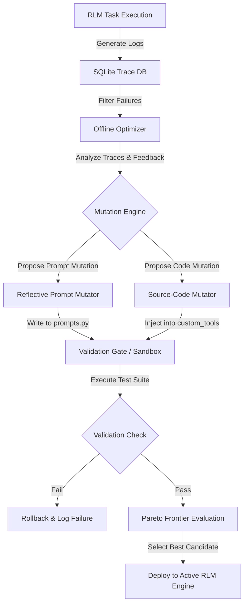

# Designing and Building a Robust Prompt and Code Self-Evolution Loop for Recursive Reasoning Models (RLM)

## Overview & Architecture of Recursive Reasoning Models
Recursive Reasoning Models (RLMs), as formalized in *Recursive Language Models* [10], represent a significant departure from standard stateless LLM invocations. Instead of wrapping the model in a single `llm.completion(prompt)` call, an RLM executes inside a CodeAct-style Read-Eval-Print Loop (REPL) environment [10], utilizing a `rlm.completion(prompt)` paradigm [11]. Under this framework, the model interacts with its context programmatically: it can write Python code, execute it in a sandbox, capture local variables, and spawn sub-agent queries or recursive child RLM calls (`llm_query` and `rlm_query` respectively) [10]. 

A robust self-evolution loop for RLMs must optimize not only the natural language instructions guiding the model’s planning, but also the Python utility code and custom tools injected into the sandbox environment [10]. To achieve this, the self-evolution architecture must combine prompt optimization, code refactoring, error tracing, and candidate selection.

---

## Comparative Analysis of Self-Evolution Frameworks
Building a self-evolution pipeline for RLMs requires adapting state-of-the-art frameworks to handle the unique complexities of recursive execution and sandboxed code. Four primary systems offer foundational methodologies:

### NousResearch hermes-agent-self-evolution
The **Hermes Agent** [1] and its self-evolution framework [2] treat agent improvement through the lens of "harness engineering." Rather than relying on online, black-box learning, it utilizes an offline "coach" model to refine the agent's core capabilities [2].
*   **Philosophy**: Focuses on source-level rewriting of markdown-formatted "skill files" and system configurations [2]. It targets the highest-value, lowest-risk components first (prompts and tool descriptions) before modifying executable agent code.
*   **Trace Storage**: Tasks are evaluated and their complete execution traces (including tool calls and shell outputs) are recorded to a local SQLite database [2].

### DSPy: Genetic-Pareto Prompt Evolution (GEPA)
Integrated as `dspy.GEPA` [4][5], GEPA formalizes prompt engineering as an evolutionary algorithm driven by natural language reflection rather than gradient steps [4].
*   **Philosophy**: Prompts are treated as learnable parameters compiled into programmatic pipelines [4]. Instead of minimizing a single scalar loss, it maintains a **Pareto frontier** of prompt candidates to balance multiple competing objectives (such as accuracy, cost, and latency) [4].
*   **Natural Language Reflection**: Rather than treating execution traces as black-box successes or failures, GEPA uses a reflection LLM to read execution traces and explain *why* a prompt candidate failed, proposing targeted textual mutations [4].

### TextGrad: Automatic Differentiation via Text
TextGrad [6] models AI systems as computation graphs where variables are text nodes (e.g., prompts, intermediate code, or final outputs) and edges represent function calls (e.g., LLM prompts, REPL executions, or unit tests) [6].
*   **Philosophy**: It translates the backpropagation algorithm into natural language [6]. The "gradient" is a rich, natural language critique explaining how a target variable should be modified to improve the overall objective.
*   **Optimization**: It updates text variables using a PyTorch-like optimizer API, where a variable is iteratively updated via:
    $$\text{Prompt} \leftarrow \text{Prompt} - \eta \cdot \text{TextualGradient}$$
    In practice, this represents an LLM call that consumes the current prompt and its textual feedback to produce an improved version [6].

### AdalFlow: LLM-AutoDiff
AdalFlow [8] is a PyTorch-like framework designed to build and auto-optimize LLM task pipelines [8][9].
*   **Philosophy**: It structures the application as an auto-differentiable graph, defining prompt instructions and few-shot examples as trainable `Parameter` objects [8].
*   **Unified Loop**: It combines textual gradient descent (LLM-AutoDiff) with few-shot demonstration bootstrapping (`BootstrapFewShot`) within a single trainer loop [8]. A `Trainer` class orchestrates training steps, evaluation steps, and validation gates [8].

---

## Key Phases of the Self-Evolution Loop

### 1. Generating Task Datasets
To evaluate and evolve an RLM, the system must maintain a representative dataset of tasks.
*   **Trace-Driven Compilation**: Following the design in [self_evolution.py](file:///C:/vazus/pyenv/scripts/self_evolution.py), the dataset is dynamically populated by mining log directories for execution rollouts. Failed or suboptimal trajectories are isolated and formatted as test inputs [2].
*   **Few-Shot Bootstrapping**: AdalFlow [8] and DSPy [4] generate few-shot candidates by running the pipeline on training inputs. Trajectories that pass validation gates are saved as exemplars (`DEMOS`) to be dynamically injected into prompt templates [8].
*   **Synthetic Synthesis**: To prevent overfitting, the offline optimizer model can generate synthetic variants of failing tasks (`dspy.synthetic`) by modifying parameters (e.g., changing constants, structures, or API formats) to test the robustness of the prompts.

### 2. Tracing Execution Errors
Because RLMs run inside a REPL sandbox, tracing errors requires capturing both semantic failures and execution exceptions.
*   **Sandbox Capture**: For RLMs running [RLM](file:///C:/vazus/pyenv/rlm-mit/rlm/core/rlm.py), execution histories capture raw code outputs, tracebacks, syntax errors, and environment exceptions (e.g., timeouts, token limit exceeded, or import errors) [10][11].
*   **Computational Graph Backpropagation**: Under TextGrad [6] and AdalFlow [8], these errors are treated as terminal nodes. A loss function (represented by a verifier LLM or a unit test harness) reviews the output and generates a critique. This critique is backpropagated through the graph, transforming technical errors into natural language instructions (e.g., "The code failed with a `NameError` because you referenced a variable that was not initialized in the current iteration scope. Add variable declarations before using them.").
*   **Structured Metric Logs**: Validation gates return a structured output containing a numerical score (0 to 1) and a textual `feedback` string [4]. The feedback string is injected directly into the optimizer's context to guide mutation [4].

### 3. Mutating Templates
Evolution involves updating the RLM's templates based on execution traces and feedback.
*   **Reflective Mutation**: The mutation engine uses a high-capability LLM to read the execution trace, identify the bottleneck, and surgically modify the system prompt. For instance, [self_evolution.py](file:///C:/vazus/pyenv/scripts/self_evolution.py) extracts the trace of a failed run and generates a mutated prompt, replacing the old `RLM_SYSTEM_PROMPT` in [prompts.py](file:///C:/vazus/pyenv/rlm-mit/rlm/utils/prompts.py) [10][11].
*   **Crossover and Merging**: DSPy's GEPA uses genetic operators to combine successful prompt instructions from multiple high-performing candidates, merging their instructions to create robust hybrid templates [4].
*   **Source-Level Code Mutation**: Beyond prompt text, self-evolution must mutate the helper tools available inside the REPL [10]. The mutation engine analyzes execution errors (e.g., missing helper functions) and writes new Python functions, injecting them into the `custom_tools` dictionary passed to the [RLM](file:///C:/vazus/pyenv/rlm-mit/rlm/core/rlm.py) initialization [10].

### 4. Running Validation Gates
Validation gates act as barriers preventing regression or syntax corruption from entering the codebase.
*   **Syntax & Static Analysis**: Before executing any code, mutated prompts and script templates are parsed (e.g., using Python's `ast` or `py_compile`) to ensure the mutations did not corrupt string syntax or introduce indentation errors.
*   **Isolated Sandbox Rollouts**: The mutated templates are executed against the validation task dataset inside isolated environments (such as `DockerREPL`, `IPythonREPL`, or Modal Sandboxes) [10]. This prevents the execution of unsafe code generated during mutation trials [10].
*   **Regression Test Harnesses**: Scripts like [run_rlm_local_test.py](file:///C:/vazus/pyenv/scripts/run_rlm_local_test.py) execute verification runs, checking if the final answers match expected outcomes and validating execution times [11].

### 5. Selecting the Best Candidates
Once a batch of mutations has been evaluated, the best candidates must be promoted.
*   **Pareto Frontier Selection**: DSPy (GEPA) evaluates mutated candidates on multiple axes [4]. A candidate is selected if it is non-dominated—meaning no other candidate is better than it across all objectives (Accuracy, Latency, API Cost) [4].
*   **Beam Search Selection**: TextGrad evaluates a beam of prompt modifications, selecting the single step that yields the highest loss reduction on the validation batch [6].
*   **Automated Git Commit / Rollback**: As implemented in [self_evolution.py](file:///C:/vazus/pyenv/scripts/self_evolution.py), if validation passes, the mutated prompt is committed to active memory. If it fails, the script triggers a rollback, restoring the codebase from a backup file (`prompts.py.bak`) and logging the failure for subsequent reflection cycles [10][11].

---

## Architectural Blueprint for RLM Self-Evolution

A robust RLM self-evolution loop must manage three levels of variables:
1.  **Orchestrator System Prompt**: Directs the high-level planning, recursion branching, and variables assembly [10].
2.  **REPL Code Snippets**: Pre-baked utility scripts or custom helper tools injected into the runtime sandbox globals [10].
3.  **Recursion Limits and Budgets**: Numerical hyperparameters determining max depth, max iterations, and token limits [10].

### Step-by-Step Evolution Algorithm
1.  **Logger Initialization**: Initialize `RLMLogger(log_dir="./logs")` to capture detailed JSONL files of all execution runs [10].
2.  **Error Identification**: Run a cron job or hook that identifies files where `final_answer` is null or execution failed [10].
3.  **Trace Assembly**: Parse the failed log, extracting the prompt, the LLM responses per iteration, and the stdout/stderr from the REPL sandbox [10].
4.  **Gradient Extraction**: Run a meta-optimizer LLM (using the TextGrad or AdalFlow prompt schemas) to output a natural language critique of the prompt/code.
5.  **Code/Prompt Mutation**: Propose adjustments to either the natural language instructions in `prompts.py` or the custom helper tools in the script namespace [10][11].
6.  **Sandbox Validation**: Run the mutated code inside an isolated `DockerREPL` [10]. Run unit tests (such as [run_rlm_local_test.py](file:///C:/vazus/pyenv/scripts/run_rlm_local_test.py)) to ensure correct behavior [11].
7.  **Pareto Filter**: Evaluate execution metrics (compaction rate, total tokens, execution time, and correctness). Add to the active prompt pool if it outperforms existing candidates.

---

## Practical Implementation Recommendations & Best Practices

*   **Model Routing Strategy**: Do not use the same LLM for execution and optimization. Use a highly capable, instruction-following model (e.g., Gemini Pro or GPT-4o) as the reflection engine and textual gradient calculator. For the execution rollouts in the sandbox, route tasks to cheaper, faster models (e.g., DeepSeek v4 Flash or Gemini Flash) to keep API costs manageable.
*   **Budgeting & Context Limits**: RLMs can consume substantial context during deep recursive runs [10]. Implement compaction gates: monitor token usage and trigger auto-summarization (`compaction=True`) when the context reaches a threshold (e.g., `compaction_threshold_pct=0.85`) to prevent model degradation or out-of-token errors [10].
*   **Sandbox Safety and Isolation**: Never run self-evolving REPL agents directly on the host machine without isolation. Utilize isolated virtual environments (like `DockerREPL`, Modal, or E2B Sandboxes) [10]. This prevents mutated code blocks from executing destructive shell commands or corrupting project files during optimization trials.
*   **Few-Shot demonstration Caching**: Cache successful REPL execution chains. Instead of regenerating prompt variables from scratch, load the highest-scoring execution chains from the SQLite database and inject them as few-shot demonstrations into the orchestrator context.

---

### Sources

*   [1] NousResearch Hermes Agent Repository: https://github.com/NousResearch/hermes-agent
*   [2] NousResearch hermes-agent-self-evolution Repository: https://github.com/NousResearch/hermes-agent-self-evolution
*   [3] DSPy GitHub Repository: https://github.com/stanfordnlp/dspy
*   [4] GEPA Paper: "GEPA: Reflective Prompt Evolution Can Outperform Reinforcement Learning" (Agrawal et al., 2025): https://arxiv.org/abs/2507.19457
*   [5] GEPA GitHub Repository: https://github.com/gepa-ai/gepa
*   [6] TextGrad Paper: "TextGrad: Automatic Differentiation via Text" (Yuksekgonul et al., 2024): https://arxiv.org/abs/2406.07496
*   [7] TextGrad GitHub Repository: https://github.com/zou-group/textgrad
*   [8] AdalFlow Paper: "LLM-AutoDiff: Auto-Differentiate Any LLM Workflow" (Yin & Wang, 2025): https://arxiv.org/abs/2501.16673
*   [9] AdalFlow GitHub Repository: https://github.com/SylphAI-Inc/AdalFlow
*   [10] Recursive Language Models Paper: "Recursive Language Models" (Zhang et al., 2026): https://arxiv.org/abs/2512.24601
*   [11] Recursive Language Models (rlm) GitHub Repository: https://github.com/alexzhang13/rlm-minimal