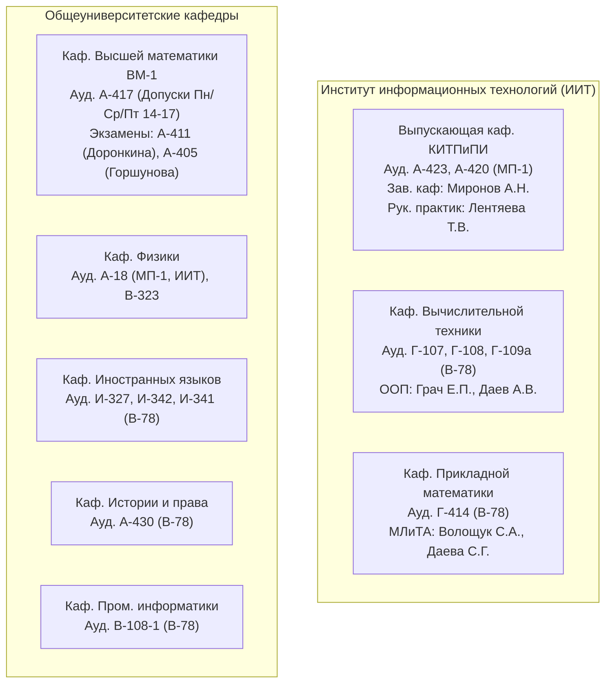

# 🎓 VAZUS ACADEMIC MASTER SSOT (Single Source of Truth)
> **Единый мастер-реестр академических задолженностей, преподавателей, кафедр и готовых артефактов.**  
> **Официальный первоисточник для всех ИИ-агентов системы Vazus SuperGraph OS.**  
> *Последняя синхронизация: 2026-10-01 13:25 MSK | Версия реестра: 2.0-Verified*

---

## 👤 1. Профиль студента (Tier 0 Invariants)
* **ФИО**: Жуков Максим Дмитриевич
* **Студенческий билет (Личный номер)**: `25И0566`
* **Группа**: **`ИВБО-22-25`** (2 курс, 3 семестр)
* **Направление подготовки**: `09.03.01` «Информатика и вычислительная техника»
* **Профиль**: «Программное обеспечение вычислительной техники и автоматизированных систем»
* **Институт**: Институт информационных технологий (ИИТ)
* **Выпускающая кафедра**: Кафедра квантовых информационных технологий и практической и прикладной информатики (**КИТПиПИ**)
* **Официальный email**: `zhukov.m.d1@edu.mirea.ru`
* **Официальный дедлайн 1-й волны ликвидации задолженностей**: **15.10.2026** (осталось 14 дней)
* **Burn-down мониторинг**: **18 задолженностей всего** | **1 закрыта** (Физкультура) | **2 готовы к сдаче** (Ознакомительная и Аналитическая практики) | **15 в процессе / очереди**

---

## 📊 2. Сквозной реестр 18 задолженностей и артефактов

| № | Дисциплина (Сем.) | Тип | ID в ЛКС / Moodle | Кафедра и Ауд. | Преподаватель | Ближайший слот | Статус | Готовые артефакты / Документы |
|---|---|---|---|---|---|---|---|---|
| **01** | **Иностранный язык** (1 сем) | Зачет | № 86146 / Moodle 16017 | Каф. ин. языков (И-327, 342, 330) | Преподаватели каф. ин. яз. | Чт 01.10 (16:20)<br>Сб 03.10 (16:20) | 🟢 Готово к сдаче | [Пособие для инженеров](file:///C:/vazus/knowledge/mirea/04_english_it/materials/Posobie_dlya_inzhenerov_MIREA.docx) |
| **02** | **Линейная алгебра** (1 сем) | Экзамен | № 66804 / Moodle 16480 | ВМ-1 (А-405, А-409) | Пронина Е.В., Горшунова Т.А. | Пн 05.10 (12:40)<br>Вт 06.10 (12:40) | ⏳ В процессе | [Манифест тестов](file:///C:/vazus/knowledge/mirea/tests/02_linear_algebra_tests_manifest.json) |
| **03** | **Математический анализ** (1 сем) | Экзамен | № 81917 / Moodle 16479 | ВМ-1 (А-411, А-405) | Доронкина С.В., Кадымов В.А. | **Пн 05.10 (16:20, А-411)** | ⏳ В процессе | [Манифест тестов](file:///C:/vazus/knowledge/mirea/tests/01_math_analysis_tests_manifest.json) |
| **04** | **Мат. логика и теория алг.** (2 сем) | Экзамен | № 86958 / Moodle 16486 | ПМ (Г-414) | Волощук С.А., Даева С.Г. | **Сб 03.10 (12:40, Г-414)**<br>Чт 08.10 (12:40) | ⏳ В процессе | [16 Лекций PDF](file:///C:/vazus/knowledge/mirea/03_math_logic/lectures/), [Study Guide](file:///C:/vazus/knowledge/mirea/03_math_logic/STUDY_GUIDE_MATH_LOGIC.md) |
| **05** | **Русский язык и культура речи** (1 сем) | Зачет | № 69956 | Каф. ин. яз. (И-341) | Комиссия кафедры | **Чт 08.10 (18:00)**<br>Пт 09.10 (16:20) | ⏳ Очный устный опрос | [Материалы к зачету](file:///C:/Users/Vaz/Documents/Русский%20язык%20и%20культура%20речи/) (5 блоков билета: теория А/Б + практика В) |
| **06** | **Основы конструирования** (2 сем) | Зачет | № 86971 | КИТПиПИ (А-423/420) | Миронов А.Н. | Чт 01.10 (14:20)<br>Чт 08.10 (14:20) | ⏳ Ожидает кафедры | Конспекты практик, согласование в А-423 |
| **07** | **ООП (Курсовая работа)** (2 сем) | КР | № 86959 | Каф. ВТ (Г-107, Г-109а) | Грач Е.П., Даев А.В. | **Пт 02.10 (18:00, Даев)**<br>Пн 05.10 (12:40, Грач) | ⏳ В процессе | Проект Python/C++, оформление ПЗ |
| **08** | **Иностранный язык** (2 сем) | Зачет | № 86146 / Moodle 16017 | Каф. ин. языков (И-327, 342) | Преподаватели каф. ин. яз. | Чт 01.10 (16:20)<br>Сб 03.10 (16:20) | 🟢 Готово к сдаче | [Расписание приема задолженностей](file:///C:/vazus/knowledge/mirea/04_english_it/materials/Расписание_приема_задолженностей_кафедра_иностранных_языков_2025-2026.pdf) |
| **09** | **Физика (Зачет)** (1 сем) | Зачет | № 78208 | Каф. физики (А-18, В-323) | Комиссия каф. физики (ИИТ) | **Чт 01.10 (16:20, А-18)** | ⏳ В процессе | Лабораторные по механике/термодинамике |
| **10** | **Ознакомительная практика** (2 сем) | Дифф. зачет | № 6082 | КИТПиПИ (Г-310, А-423) | Зуев А.С., Лентяева Т.В. | Ср 07.10 (12:40, Г-310)<br>Ежедневно А-423 | 🟢 **100% ГОТОВО** | [Отчет DOCX (37 стр.)](file:///C:/Users/Vaz/Documents/Ознакомительная_Практика_МИРЭА/ЖуковМД_Ознакомительная_практика.docx), [PDF](file:///C:/Users/Vaz/Documents/Ознакомительная_Практика_МИРЭА/ЖуковМД_Ознакомительная_практика.pdf), [Видео 1 (21:45)](file:///C:/Users/Vaz/Documents/Ознакомительная_Практика_МИРЭА/video1_ritchie_unix_1080p.mp4), [Видео 2 (22:10)](file:///C:/Users/Vaz/Documents/Ознакомительная_Практика_МИРЭА/video2_arpanet_internet_1080p.mp4) |
| **11** | **Физическая культура и спорт** (1 сем) | Зачет | № 72287 | Каф. физвоспитания (С-20) | Кафедра физ. воспитания | **СДАНО (30.09)** | ✅ **СДАНО** | Зачет сдан в ФОК С-20, долг погашен |
| **12** | **Основы росс. государственности** (1 сем) | Зачет | № 82576 | Каф. истории и права (А-430) | Комиссия кафедры | **Чт 01.10 (18:00, А-430)**<br>Чт 08.10 (18:00) | 🟢 Готово к сдаче | Модули СДО пройдены, собеседование |
| **13** | **Линейная алгебра** (2 сем) | Экзамен | № 66804 / Moodle 16480 | ВМ-1 (А-405, А-9а) | Горшунова Т.А., Егорова А.А. | **Пт 02.10 (14:20, А-9а)**<br>**Вт 06.10 (12:40, А-405)** | ⏳ В процессе | Типовой расчет: Квадратичные формы |
| **14** | **ООП (Экзамен)** (2 сем) | Экзамен | № 86959 | Каф. ВТ (Г-107, Г-109а) | Грач Е.П., Даев А.В. | **Пт 02.10 (18:00, Даев)**<br>Пн 05.10 (12:40, Грач) | ⏳ В процессе | Билеты: ООП, шаблоны, полиморфизм |
| **15** | **Математический анализ** (2 сем) | Экзамен | № 81917 / Moodle 16479 | ВМ-1 (А-411) | Доронкина С.В. | **Пн 05.10 (16:20, А-411)**<br>Пн 12.10 (16:20) | ⏳ В процессе | Интегралы, ряды, Тейлор, диф. уравнения |
| **16** | **Физика (Экзамен)** (2 сем) | Экзамен | № 78208 | Каф. физики (А-18, В-323) | Комиссия каф. физики (ИИТ) | **Чт 01.10 (16:20, А-18)**<br>Вт 13.10 (16:20) | ⏳ В процессе | Электромагнетизм, волновая оптика, кванты |
| **17** | **История России** (1 сем) | Экзамен | № 82054 | Каф. истории (А-430) | Комиссия кафедры | **Чт 01.10 (18:00, А-430)**<br>Чт 08.10 (18:00) | 🟢 Готово к сдаче | Тестирование / билеты |
| **18** | **Информатика** (1 сем) | Экзамен | № 85415 | Пром. информатика (В-108-1) | Комиссия кафедры / Зуев А.С. | Ср 07.10 (12:40)<br>Ср 14.10 (12:40) | ⏳ В процессе | [Вопросы на сессию](file:///C:/vazus/knowledge/mirea/informatics/Аттестация_Вопросы_на_сессию.docx), [Практики 1, 5, 6](file:///C:/vazus/knowledge/mirea/informatics/) |
| **—** | **Аналитическая практика** (3 сем) | Дифф. зачет | — | КИТПиПИ (А-423/420) | Лентяева Т.В. | По графику 3 семестра | 🟢 **100% ГОТОВО** | [Отчет DOCX (паспорт сервера + бенчмарки)](file:///C:/Users/Vaz/Documents/Аналитическая_Практика_МИРЭА/ЖуковМД_Аналитическая_практика.docx) |

---

## 🏢 3. Справочник кафедр и контактных лиц



### Детальные координаты кафедр:
1. **Кафедра КИТПиПИ (Выпускающая)**:
   * **Где**: Корпус МП-1, 4 этаж, ауд. **А-423 / А-420**.
   * **Зав. кафедрой**: **Миронов Антон Николаевич** (д.т.н., профессор). Принимает по четвергам в 14:20.
   * **Руководитель практик**: **Лентяева Татьяна Владимировна** (к.э.н., доцент). Принимает в Г-327 / А-420 (Чт 10:40 и 18:00).
   * **Преподаватель**: **Зуев Александр Сергеевич** (Ознакомительная практика) — ауд. Г-310 (Ср 12:40–15:50).

2. **Кафедра Высшей математики (ВМ-1)**:
   * **Где**: Корпус МП-1, 4 этаж, ауд. **А-417** (преподавательская).
   * **Допуски к экзаменам**: Выдаются строго **Пн, Ср, Пт с 14:00 до 17:00 в А-417**. Без допуска экзаменатор билет не выдает!
   * **Матанализ**: **Доронкина Светлана Владимировна** — ауд. **А-411** (Пн 16:20–17:50).
   * **Линейная алгебра**: **Горшунова Татьяна Алексеевна** — ауд. **А-405** (Ср 14:20–15:50), **Егорова А.А.** — ауд. **А-9а** (Пт 14:20).

3. **Кафедра Вычислительной техники (ВТ)**:
   * **Где**: Корпус В-78, 1 этаж, ауд. **Г-107, Г-108, Г-109а**.
   * **ООП (КР и Экзамен)**:
     * **Даев Александр Владимирович** — ауд. **Г-109а** (Пятница, 18:00–19:30).
     * **Грач Евгений Павлович** — ауд. **Г-107** (Понедельник, 12:40).
     * **Путуридзе Зураб Шалвович** — ауд. **Г-107** (Среда, 12:40–15:50).

4. **Кафедра Прикладной математики (ПМ)**:
   * **Где**: Корпус В-78, 4 этаж, ауд. **Г-414**.
   * **Мат. логика и теория алгоритмов**:
     * **Волощук Светлана Анатольевна** — ауд. **Г-414** (Четверг, 10:40 / 12:40).
     * **Даева С.Г.** — ауд. **Г-414** (Суббота, 12:40–14:10).
     * **Ледовская Е.В.** — ауд. **Г-414** (Пятница, 10:40–12:10).

5. **Кафедра Физики**:
   * **Где**: Корпус МП-1, ауд. **А-18** (для студентов ИИТ); Корпус В-78, преподавательская **В-323**.
   * **Приём задолженностей**: Четверги (16:20, А-18) и Вторники (16:20, В-323).

6. **Кафедра Иностранных языков**:
   * **Где**: Корпус В-78 (ИИТ), 3 этаж, ауд. **И-327, И-342, И-330, И-341, И-343**.
   * **Английский язык**: Вт (И-330), Чт (И-327/342), Сб (И-343/344) — **5 пара (16:20–17:50)**.
   * **Русский язык**: ауд. **И-341** (Чт 18:00, Пт 16:20, Сб 10:40).

7. **Кафедра Истории и права**:
   * **Где**: Корпус В-78, 4 этаж, ауд. **А-430**.
   * **Основы государственности и История России**: Четверги **01.10, 08.10, 15.10 с 18:00 до 19:30** (6 пара).

---

## 📂 4. Карта локальных артефактов (Готовые работы на диске)

| Категория | Локальный путь к чистовому файлу | Описание и статус |
|---|---|---|
| **Ознакомительная практика** | [ЖуковМД_Ознакомительная_практика.docx](file:///C:/Users/Vaz/Documents/Ознакомительная_Практика_МИРЭА/ЖуковМД_Ознакомительная_практика.docx) | 37 стр., ГОСТ, дневник, инд. задание, анализ 80 источников |
| **Ознакомительная практика (PDF)** | [ЖуковМД_Ознакомительная_практика.pdf](file:///C:/Users/Vaz/Documents/Ознакомительная_Практика_МИРЭА/ЖуковМД_Ознакомительная_практика.pdf) | Версия для печати |
| **Видео 1 (Ритчи и UNIX)** | [video1_ritchie_unix_1080p.mp4](file:///C:/Users/Vaz/Documents/Ознакомительная_Практика_МИРЭА/video1_ritchie_unix_1080p.mp4) | **21:45**, Full HD 1080p, студийный звук, дакинг (230 МБ) |
| **Видео 2 (ARPANET и Веб)** | [video2_arpanet_internet_1080p.mp4](file:///C:/Users/Vaz/Documents/Ознакомительная_Практика_МИРЭА/video2_arpanet_internet_1080p.mp4) | **22:10**, Full HD 1080p, студийный звук, дакинг (209 МБ) |
| **Аналитическая практика** | [ЖуковМД_Аналитическая_практика.docx](file:///C:/Users/Vaz/Documents/Аналитическая_Практика_МИРЭА/ЖуковМД_Аналитическая_практика.docx) | 48 КБ, титульник МИРЭА, задание, тесты ПК, паспорт сервера HPE |
| **Математический анализ 3** | [Типовой_расчет_Матанализ_3_Вариант_6.docx](file:///C:/Users/Vaz/Documents/mirea_study_os/01_Disciplines/04_Higher_Mathematics/Типовой_расчет_Матанализ_3_Вариант_6_Жуков_ИВБО-22-25.docx) | Полностью решенный типовой расчет (вар. 6) с графиками и формулами |
| **ИТ-Инфраструктура** | [Курсовая_Жуков_ИВБО-22-25.docx](file:///C:/Users/Vaz/Documents/mirea_study_os/01_Disciplines/02_IT_Infrastructure/Курсовая_Жуков_ИВБО-22-25.docx) | 65 стр., Вариант №6, модель КРОК, готово к защите |
| **Математическая логика** | [STUDY_GUIDE_MATH_LOGIC.md](file:///C:/vazus/knowledge/mirea/03_math_logic/STUDY_GUIDE_MATH_LOGIC.md) | Конспект формул, Z3 предикаты, лекции 1–16 в PDF |
| **Информатика** | [Аттестация_Вопросы_на_сессию.docx](file:///C:/vazus/knowledge/mirea/informatics/Аттестация_Вопросы_на_сессию.docx) | Список экзаменационных вопросов и практические работы 1, 5, 6 |

---

## 🤖 5. Машиночитаемый блок состояния (JSON Agent State Block)
> Любой ИИ-агент (Antigravity, Hermes, Claude, GPT) может программно прочитать этот блок, извлечь текущие параметры и обновить их.

```json:agent_state
{
  "schema_version": "2.0.0",
  "last_updated_msk": "2026-10-01T13:25:00+03:00",
  "student": {
    "name": "Жуков Максим Дмитриевич",
    "student_id": "25И0566",
    "group": "ИВБО-22-25",
    "specialty": "09.03.01",
    "chair": "КИТПиПИ",
    "institute": "ИИТ",
    "deadline_stage_1": "2026-10-15"
  },
  "metrics": {
    "total_debts": 18,
    "closed_debts": 1,
    "ready_to_submit": 2,
    "pending_debts": 15
  },
  "active_debts": [
    {"id": 1, "subject": "Иностранный язык (1 сем)", "type": "зачет", "status": "READY", "room": "И-327", "next_date": "2026-10-01 16:20"},
    {"id": 2, "subject": "Линейная алгебра (1 сем)", "type": "экзамен", "status": "IN_PROGRESS", "room": "А-405", "next_date": "2026-10-05 12:40"},
    {"id": 3, "subject": "Математический анализ (1 сем)", "type": "экзамен", "status": "IN_PROGRESS", "room": "А-411", "next_date": "2026-10-05 16:20"},
    {"id": 4, "subject": "Мат. логика и теория алгоритмов", "type": "экзамен", "status": "IN_PROGRESS", "room": "Г-414", "next_date": "2026-10-03 12:40"},
    {"id": 5, "subject": "Русский язык и культура речи", "type": "зачет", "status": "READY", "room": "И-341", "next_date": "2026-10-01 18:00"},
    {"id": 6, "subject": "Основы конструирования", "type": "зачет", "status": "PENDING", "room": "А-423", "next_date": "2026-10-08 14:20"},
    {"id": 7, "subject": "ООП (Курсовая работа)", "type": "курсовая работа", "status": "IN_PROGRESS", "room": "Г-109а", "next_date": "2026-10-02 18:00"},
    {"id": 8, "subject": "Иностранный язык (2 сем)", "type": "зачет", "status": "READY", "room": "И-327", "next_date": "2026-10-01 16:20"},
    {"id": 9, "subject": "Физика (Зачет)", "type": "зачет", "status": "IN_PROGRESS", "room": "А-18", "next_date": "2026-10-01 16:20"},
    {"id": 10, "subject": "Ознакомительная практика", "type": "дифф. зачет", "status": "100% READY", "room": "Г-310/А-423", "next_date": "2026-10-07 12:40"},
    {"id": 11, "subject": "Физическая культура и спорт", "type": "зачет", "status": "CLOSED", "room": "С-20", "closed_date": "2026-09-30"},
    {"id": 12, "subject": "Основы российской государственности", "type": "зачет", "status": "READY", "room": "А-430", "next_date": "2026-10-01 18:00"},
    {"id": 13, "subject": "Линейная алгебра (2 сем)", "type": "экзамен", "status": "IN_PROGRESS", "room": "А-9а", "next_date": "2026-10-02 14:20"},
    {"id": 14, "subject": "ООП (Экзамен)", "type": "экзамен", "status": "IN_PROGRESS", "room": "Г-109а", "next_date": "2026-10-02 18:00"},
    {"id": 15, "subject": "Математический анализ (2 сем)", "type": "экзамен", "status": "IN_PROGRESS", "room": "А-411", "next_date": "2026-10-05 16:20"},
    {"id": 16, "subject": "Физика (Экзамен)", "type": "экзамен", "status": "IN_PROGRESS", "room": "А-18", "next_date": "2026-10-01 16:20"},
    {"id": 17, "subject": "История России", "type": "экзамен", "status": "READY", "room": "А-430", "next_date": "2026-10-01 18:00"},
    {"id": 18, "subject": "Информатика", "type": "экзамен", "status": "IN_PROGRESS", "room": "В-108-1", "next_date": "2026-10-07 12:40"}
  ]
}
```

---

## 🛠️ 6. Протокол обновления реестра для ИИ-агентов (Mutation Protocol)
1. **При закрытии задолженности**:
   - Агент меняет статус в строке таблицы и в блоке JSON на `CLOSED`.
   - Инкрементирует `metrics.closed_debts` и декрементирует `metrics.pending_debts`.
   - Вызывает `UPDATE mirea_milestones SET status = 'Сдано' WHERE id = ...` в `C:\vazus\services\memory\vazus.db`.
2. **При добавлении / редактировании артефактов**:
   - Все новые файлы сохранять строго в `C:\Users\Vaz\Documents\` или `C:\vazus\knowledge\mirea\`.
   - Немедленно добавлять абсолютную ссылку с файловой схемой `file:///` в раздел 4 («Карта локальных артефактов»).
3. **Неизменность формата**:
   - Структура заголовков и синтаксис JSON-блока строго защищены от ломки парсеров.
