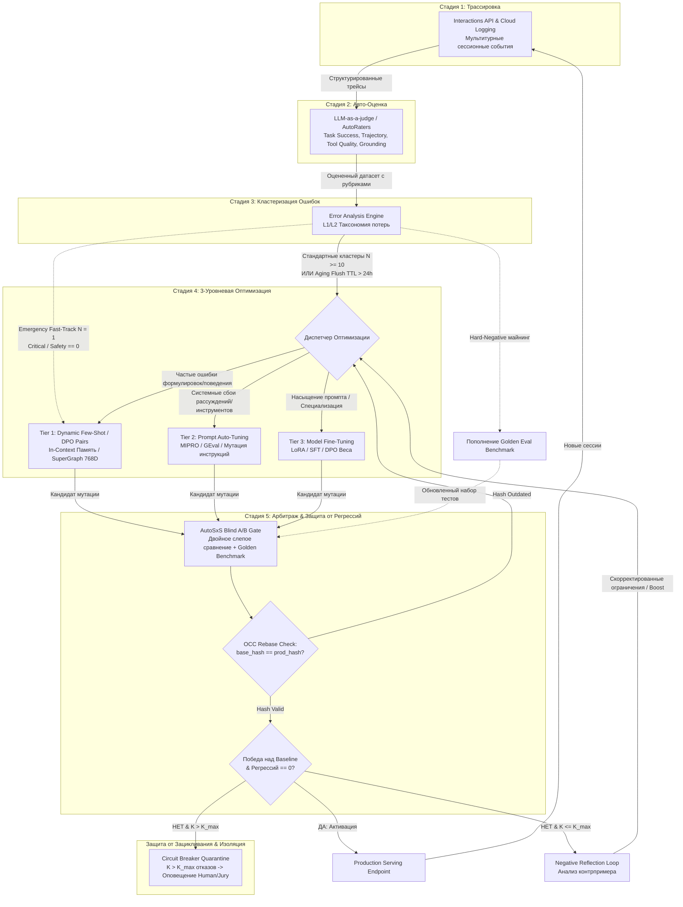

# ADR-005: Архитектура Непрерывного Самоулучшения Агентов (Eval Quality Flywheel) в Vazus SuperGraph OS

* **Статус**: ПРИНЯТО (Согласовано в рамках Milestone 5 SuperGraph Evolution, сентябрь 2026)
* **Контекст**: Для автономного функционирования субагентов Vazus OS (`open_deep_researcher`, `rlm_code_engineer`, `verifier_worker`) необходим математически замкнутый контур непрерывного мониторинга, автоматической оценки качества, кластеризации ошибок и многоуровневой оптимизации с защитой от регрессий.

---

## 1. Контекст и Проблематика

Традиционные подходы к разработке агентов страдают от «статической фиксации» (Static Freeze):
1. **Отсутствие замкнутого фидбека**: Логи и трейсы выполнения накапливаются в хранилищах, но не приводят к автоматическому исправлению ошибок. Любое изменение требует ручного анализа инженером.
2. **Риск деградации (Catastrophic Regressions)**: Точечные правки системных промптов или дообучение весов (LoRA/SFT) часто улучшают один граничный кейс, но ломают 10 других ранее работавших сценариев.
3. **Разомкнутые контуры (Dangling Loops)**: В большинстве систем детекция сбоя либо зависает в очереди без диспетчеризации, либо отбракованная мутация удаляется без извлечения урока (критики), что приводит к зацикливанию оптимизатора на одних и тех же ошибках.

---

## 2. Принятое Решение: 5-Стадийный Замкнутый Контур (Eval Quality Flywheel)

Архитектура объединяет Google Enterprise Agent Platform (`google.genai` / `agentplatform`), Interactions API, Cloud Logging и локальную память Vazus SuperGraph в единый 5-стадийный цикл:

### Стадия 1 — Мультитурная Трассировка Сессий (Session Event Tracing)
* **Движок**: `Interactions API` + `Cloud Logging` с экспортом в BigQuery.
* **Модель данных**: Иерархия `EvaluationDataset` $\to$ `AgentData` $\to$ `ConversationTurn` $\to$ `AgentEvent`.
* **Полнота контекста**: Каждый шаг содержит `author`, `role`, `parts`, `thought` (внутренний монолог/планирование), точный `tool_call` (имя и аргументы) и `tool_response`.
* **Сквозной идентификатор**: `trace_id`, `session_id`, `version_hash` для 100% атрибуции.

### Стадия 2 — Автоматическая Оценка Траекторий (AutoRaters & Rubrics)
* **Адаптивные мультитурные метрики**:
  * `multi_turn_task_success`: Достигнута ли истинная цель пользователя.
  * `multi_turn_trajectory_quality`: Эффективность графа переходов, отсутствие холостых и избыточных шагов.
  * `multi_turn_tool_use_quality`: Корректность выбора инструментов, валидность параметров, реакция на ошибки инструментов.
  * `multi_turn_general_quality`: Логическая связность и тон диалога.
* **Статические инварианты**:
  * `grounding`: Фактическая точность, отсутствие противоречий с контекстом.
  * `hallucination`: Проверка соответствия утверждений реальным выходам инструментов.
  * `safety`: Проверка политик безопасности и конфиденциальности.
* **Режим работы**: Серверные предиктивные AutoRaters (`types.RubricMetric`) + кастомные `CodeExecutionMetric` в изолированной песочнице.

### Стадия 3 — Кластеризация Ошибок и Таксономия Потерь (Error Analysis)
* **Движок**: `client.evals.generate_loss_clusters(metric="multi_turn_task_success", config={"max_top_cluster_count": 5})`.
* **Иерархическая таксономия**:
  * **L1**: Верхнеуровневый класс деградации (`Planning Failure`, `Tool Selection Error`, `Instruction Drift`, `Premature Termination`, `Context Overflow`).
  * **L2**: Конкретный механизм сбоя (`Hallucinated Parameter`, `Missing Required Field`, `Ignored Negative Constraint`, `Infinite Loop on Tool Error`).
* **Многоприоритетный триггер оптимизации (Multi-Priority Dispatch)**:
  1. **Emergency Fast-Track ($N = 1$)**: Критические нарушения безопасности (`safety == 0.0`), утечки данных или фатальные падения инструментов немедленно активируют аварийный тикет в Tier 1.
  2. **Standard Batch ($N \ge 10$)**: Стандартные кластеры накапливаются до статистически значимого размера $N \ge 10$.
  3. **Aging TTL Flush ($\Delta t > 24\text{h}$, $N \ge 3$)**: Редко воспроизводимые ошибки не зависают в буфере навечно, а сбрасываются в Tier 1 по истечении 24 часов.

### Стадия 4 — 3-Уровневая Иерархия Оптимизации (3-Tier Optimization Hierarchy)
1. **Tier 1 (Fast-Path / In-Context Memory)**:
   * **Механизм**: Динамический подбор Few-Shot демонстраций и пар DPO (Chosen/Rejected) через 768D эмбеддинги (`UnifiedGoogleEmbedder`) в SuperGraph Memory.
   * **Время реакции**: < 50 мс, нулевая стоимость дообучения, мгновенное действие на следующий запрос.
2. **Tier 2 (Warm-Path / Prompt Auto-Tuning)**:
   * **Механизм**: Эволюционная мутация системных инструкций (`DSPy MIPRO`, `GEval Prompt Mutator`). На основе таксономии L1/L2 генерируются целевые дополнения к промпту, устраняющие выявленный сбой.
   * **Время реакции**: 5–15 минут, итеративный синтез с валидацией на локальной выборке.
3. **Tier 3 (Cold-Path / Parametric LoRA & SFT)**:
   * **Механизм**: Параметрическая адаптация базовой модели через `agent-platform-tuning` (LoRA/PEFT, SFT, DPO). Применяется, когда возможности промпт-инжиниринга исчерпаны (насыщение метрик).
   * **Время реакции**: 1–4 часа, тяжелое облачное обучение на кластере GPU/TPU.
* **Terminal Escalation Policy**: При неудаче Tier 3 после $K_{\max} = 3$ итераций задача изолируется в `Quarantine_DeadLetter_Queue` с генерацией отчета для Concordia Multi-Agent Jury или инженера, предотвращая бесконечный расход квот.

### Стадия 5 — Арбитраж, Защита от Регрессий и Конкурентность (AutoSxS & OCC)
* **Слепое A/B тестирование (AutoSxS)**: Кандидат $M_{cand}$ и текущий базовый агент $M_{base}$ запускаются на контрольном датасете со сменой порядка (Pairwise Swap: $A \text{ vs } B$ и $B \text{ vs } A$) для нейтрализации Position Bias.
* **Формула пропуска в Production**:
  $$M_{cand} \to \text{PRODUCTION} \iff \Big( \text{WinRate}(M_{cand}, M_{base}) \ge 0.50 + \epsilon \Big) \;\land\; \Big( \text{Regressions}(M_{cand}, \mathcal{D}_{golden}) = 0 \Big) \;\land\; \text{OCC}(\text{base\_hash})$$
  где $\epsilon = 0.05$ (порог статистической значимости), а $\mathcal{D}_{golden}$ — неизменяемый золотой эталон системы.
* **Optimistic Concurrency Control (OCC Rebase)**: Перед релизом проверяется условие $\text{base\_hash}(M_{cand}) == \text{current\_prod\_hash}$. Если пока шла оценка другой кластер обновил прод, кандидат ребейзится на актуальный промпт и валидируется повторно, исключая потерю обновлений (Lost Updates).
* **Negative Reflection Loop**: 
  - При регрессиях ($N_{regr} > 0$): извлекается `CritiquePayload` с жесткими негативными ограничениями.
  - При нейтральном исходе ($\text{WinRate} < 0.55 \land N_{regr} = 0$): мутация признается недостаточно выразительной и активирует генерацию с повышенной вариативностью (Exploration Boost / Temperature Bump).

---

## 3. Математическое Доказательство Замкнутости Контуров

Система формализуется как ориентированный граф состояний $\mathcal{G} = (\mathcal{V}, \mathcal{E})$:
$$\mathcal{V} = \{ \text{Serve}, \text{Trace}, \text{Eval}, \text{Cluster}, \text{Optimize}, \text{Arbitrate}, \text{Reflect}, \text{Enrich}, \text{Quarantine} \}$$

### Инварианты Замкнутости (Closure Invariants):
1. **$I_1$ (Отсутствие стоков / Bounded Termination)**:
   $$\forall v \in \mathcal{V} \setminus \{ \text{Quarantine} \}: \quad \text{OutDegree}(v) \ge 1$$
   Единственным терминальным состоянием сбоя является $\text{Quarantine}$ с обязательным внешним прерыванием (Human/Jury Alert), что предотвращает бесконечные циклы.
2. **$I_2$ (Гарантированная диспетчеризация ошибки)**:
   $$\forall e \in \mathcal{E}_{fail}: \quad e \xrightarrow{\text{deterministic}} \text{Cluster} \xrightarrow{\text{routed}} \text{Optimize}(\text{Tier}_k)$$
   Критические сбои диспетчеризируются мгновенно ($N=1$), пакетные — по порогу ($N \ge 10$), а редкие — по тайм-ауту ($\text{TTL} > 24\text{h}$).
3. **$I_3$ (Строгий изоляционный гейт и атомарность версий)**:
   $$\text{Path}(\text{Optimize} \to \text{Serve}) = \{ (\text{Optimize}, \text{Arbitrate}), (\text{Arbitrate}, \text{Serve}) \}$$
   Прямой переход из $\text{Optimize}$ в $\text{Serve}$ топологически невозможен без прохождения $\text{Arbitrate}$ и валидации OCC хэша.
4. **$I_4$ (Замкнутый контур рефлексии с Circuit Breaker)**:
   $$\text{Arbitrate}_{\text{reject}} \xrightarrow{K \le K_{\max}} \text{Reflect} \xrightarrow{} \text{Optimize}, \quad \text{Arbitrate}_{\text{reject}} \xrightarrow{K > K_{\max}} \text{Quarantine}$$
   Сбой верификации возвращает градиент критики, но счетчик попыток $K \le 3$ гарантирует невозможность бесконечного зацикливания.
5. **$I_5$ (Непрерывное пополнение золотого датасета)**:
   $$\text{Cluster}_{\text{novel}} \to \text{Enrich} \to \mathcal{D}_{golden}$$
   Каждый новый обнаруженный класс ошибки расширяет эталонный бенчмарк $\mathcal{D}_{golden}$, предотвращая будущие регрессии.
6. **$I_6$ (Изоляция параллельных мутаций / OCC)**:
   $$\forall M_A, M_B: \quad \text{Deploy}(M_B) \implies \text{Valid}(\text{base\_hash}(M_B) == \text{prod\_hash})$$
   Параллельные мутации из разных кластеров не могут перетереть друг друга.

---

## 4. Связанные Заметки и Топология Obsidian

* Master Hub: [[Zettel_Continuous_Agent_Self_Improvement_Flywheel]]
* Стадия 1 (Трассировка): [[Zettel_Multi_Turn_Session_Event_Tracing]]
* Стадия 2 (Авто-Оценка): [[Zettel_Autonomous_Trajectory_Evaluation_AutoRaters]]
* Стадия 3 (Кластеризация): [[Zettel_Error_Analysis_Loss_Taxonomy_Clustering]]
* Стадия 4 (Оптимизация): [[Zettel_Three_Tier_Agent_Optimization_Hierarchy]]
  * Tier 1: [[Zettel_Dynamic_Few_Shot_In_Context_Learning]]
  * Tier 2: [[Zettel_Automated_Prompt_Tuning_and_DSPy_Evolution]]
  * Tier 3: [[Zettel_Parametric_Fine_Tuning_LoRA_SFT_DPO]]
* Стадия 5 (Арбитраж): [[Zettel_AutoSxS_Blind_Arbitration_and_Regression_Gate]]
* Формальная Верификация: [[Zettel_Closed_Feedback_Loop_Formal_Verification]]
* Интерактивная Карта: [[agent_eval_quality_flywheel]] (Холст: [[agent_eval_quality_flywheel.canvas]])
* Предшествующий ADR: [[ADR_004_CODE_INTELLIGENCE_5LAYERS]]

