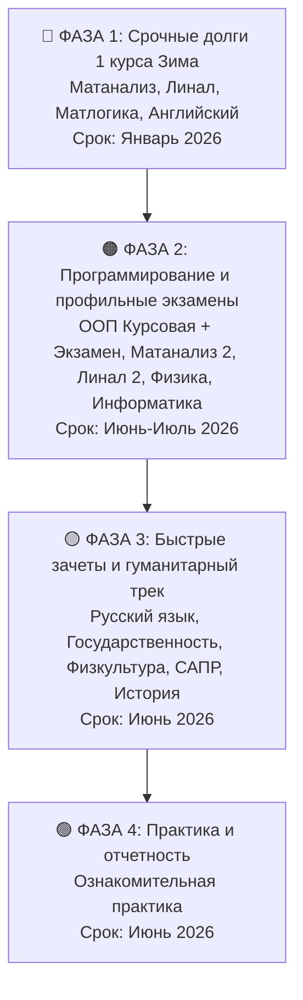

# 🎓 Полный Реестр и Дорожная Карта Ликвидации 18 Задолженностей РТУ МИРЭА

> ⚡ **Главная стратегическая цель**: Полное устранение риска отчисления по правилу «Задолженность $> 1$ года» и последовательная сдача всех 18 академических долгов по фазам.
> 📱 **Мобильная версия для заметок телефона**: [[PHONE_NOTES_CHECKLIST|Открыть мобильный чек-лист для телефона]]
> 📗 **Master Excel**: [[C:/vazus/data/life_operating_system.xlsx|Открыть Таблицу Excel]]

---

## 🗺️ Последовательный план сдачи (По Фазам)

---

## 🔴 Фаза 1: Критический приоритет (Зимняя сессия 1-го курса, риск >1 года)
| № | Дисциплина | Тип | Семестр | Ведомость | Дедлайн | AI Тьютор / Блокнот | Заметка Obsidian | Статус |
|:---:|:---|:---:|:---:|:---:|:---:|:---:|:---:|:---:|
| 1 | **Иностранный язык (английский)** | Зачет | 1/3 | № 86146 | `29.12.2025` | [🚀 NotebookLM](https://notebook.google.com/notebook/a5cb58c1-d990-4d25-9fc0-fd3981437f70) | [[04_English_IT|04_English_IT]] | 🟢 `ACTIVE_NOTEBOOK` |
| 2 | **Линейная алгебра и аналитическая геометрия** | Экзамен | 1/2 | № 66804 | `15.01.2026` | [🚀 NotebookLM](https://notebook.google.com/notebook/94b713d9-2a5b-4d7e-a4a1-8804bfd2031e) | [[02_Linear_Algebra|02_Linear_Algebra]] | 🟢 `ACTIVE_NOTEBOOK` |
| 3 | **Математический анализ (часть 1)** | Экзамен | 1/3 | № 81917 | `19.01.2026` | [🚀 NotebookLM](https://notebook.google.com/notebook/b61efe0f-9b7f-4438-8792-79aa13671a79) | [[01_Math_Analysis|01_Math_Analysis]] | 🟢 `ACTIVE_NOTEBOOK` |
| 4 | **Математическая логика и теория алгоритмов** | Экзамен | 1/1 | № 86958 | `29.01.2026` | [🚀 NotebookLM](https://notebook.google.com/notebook/6236ddcb-f6af-432a-bc5f-6144eea9d94b) | [[03_Math_Logic|03_Math_Logic]] | 🟢 `ACTIVE_NOTEBOOK` |

---

## 🟠 Фаза 2: Программирование и профильные экзамены (Летняя сессия)
| № | Дисциплина | Тип | Семестр | Ведомость | Дедлайн | Материалы | Заметка Obsidian | Статус |
|:---:|:---|:---:|:---:|:---:|:---:|:---:|:---:|:---:|
| 7 | **Объектно-ориентированное программирование (Курсовая)** | Курсовая работа | 1/1 | № 86959 | `06.06.2026` | Проект C++ / Python + пояснительная записка | [[07_OOP_Coursework|07_OOP_Coursework]] | ⚪ `PLANNED` |
| 9 | **Физика (Зачет)** | Зачет | 2/2 | № 78208 | `08.06.2026` | Лабораторные работы по механике, оптике, термодинамике | [[09_Physics_Pass|09_Physics_Pass]] | ⚪ `PLANNED` |
| 13 | **Линейная алгебра (часть 2)** | Экзамен | 2/2 | № 66804 | `16.06.2026` | Линейные операторы, квадратичные формы, жорданова форма | [[13_Linear_Algebra_Part2|13_Linear_Algebra_Part2]] | ⚪ `PLANNED` |
| 14 | **Объектно-ориентированное программирование (Экзамен)** | Экзамен | 1/1 | № 86959 | `19.06.2026` | Билеты по SOLID, паттернам GoF, виртуальным таблицам | [[14_OOP_Exam|14_OOP_Exam]] | ⚪ `PLANNED` |
| 15 | **Математический анализ (часть 2)** | Экзамен | 2/3 | № 81917 | `22.06.2026` | Неопределенные/определенные интегралы, ряды, ФНП | [[15_Math_Analysis_Part2|15_Math_Analysis_Part2]] | ⚪ `PLANNED` |
| 16 | **Физика (Экзамен)** | Экзамен | 2/2 | № 78208 | `26.06.2026` | Теория электромагнетизма, оптики и квантовой физики | [[16_Physics_Exam|16_Physics_Exam]] | ⚪ `PLANNED` |
| 18 | **Информатика** | Экзамен | 2/2 | № 85415 | `04.07.2026` | Алгоритмы, структуры данных, представление чисел в ЭВМ | [[18_Informatics_Exam|18_Informatics_Exam]] | ⚪ `PLANNED` |

---

## 🟡 Фаза 3: Быстрые зачеты и гуманитарный трек (Сдача за 1–2 вечера)
| № | Дисциплина | Тип | Семестр | Ведомость | Дедлайн | Материалы | Заметка Obsidian | Статус |
|:---:|:---|:---:|:---:|:---:|:---:|:---:|:---:|:---:|
| 5 | **Русский язык и культура речи** | Зачет | 1/1 | № 69956 | `05.06.2026` | Онлайн-тесты и рефераты в СДО | [[05_Russian_Language|05_Russian_Language]] | ⚡ `FAST_TRACK` |
| 6 | **Основы конструирования** | Зачет | 1/1 | № 86971 | `05.06.2026` | Чертежи, ЕСКД, САПР отчеты | [[06_Engineering_Basics|06_Engineering_Basics]] | ⚡ `FAST_TRACK` |
| 8 | **Иностранный язык (часть 2)** | Зачет | 2/3 | № 86146 | `08.06.2026` | Пособие инженеров МИРЭА (Unit 3-5) | [[08_English_Part2|08_English_Part2]] | ⚡ `FAST_TRACK` |
| 11 | **Физическая культура и спорт** | Зачет | 1/3 | № 72287 | `09.06.2026` | Реферат по ЗОЖ / сдача нормативов | [[11_Physical_Education|11_Physical_Education]] | ⚡ `FAST_TRACK` |
| 12 | **Основы российской государственности** | Зачет | 1/1 | № 82576 | `11.06.2026` | Тесты СДО + эссе | [[12_Russian_Statehood|12_Russian_Statehood]] | ⚡ `FAST_TRACK` |
| 17 | **История России** | Экзамен | 2/2 | № 82054 | `29.06.2026` | Хронологические конспекты, даты, тесты | [[17_History_of_Russia|17_History_of_Russia]] | ⚡ `FAST_TRACK` |

---

## 🟢 Фаза 4: Практика и отчетность
| № | Дисциплина | Тип | Семестр | Ведомость | Дедлайн | Материалы | Заметка Obsidian | Статус |
|:---:|:---|:---:|:---:|:---:|:---:|:---:|:---:|:---:|
| 10 | **Ознакомительная практика** | Дифф. зачет | 1/1 | № 6082 | `09.06.2026` | Дневник практики, характеристика, отчет | [[10_Introductory_Practice|10_Introductory_Practice]] | ⚪ `PLANNED` |
