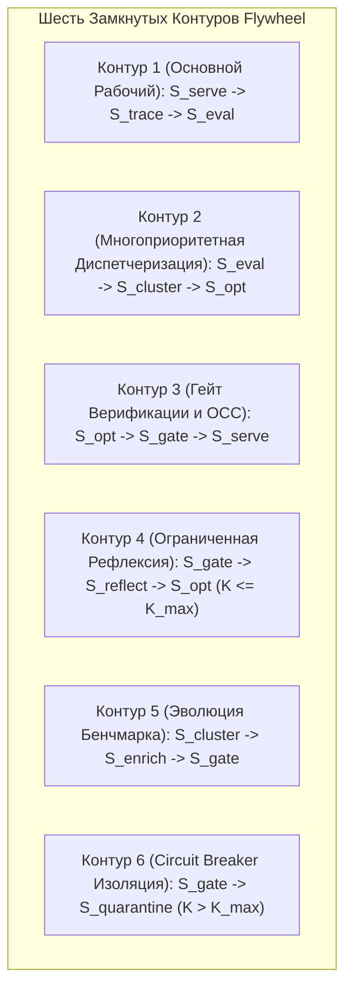

# Formal Verification of Closed Feedback Loops in Agent Self-Improvement

## 📌 Core Protocol & Claim

В кибернетических системах разомкнутые контуры (Open Loops) неизбежно ведут к энтропии: ошибки накапливаются без реакции, либо сгенерированные исправления деградируют систему без контроля.

В данной заметке представлено **строгое графовое и логическое доказательство замкнутости (Formal Loop Closure Proof)** архитектуры Eval Quality Flywheel в Vazus SuperGraph OS. Доказывается, что граф состояний системы не содержит стоков ($\text{Sink-Free}$), а любые состояния сбоев или отклонений мутаций детерминированно замыкаются на корректирующие контуры.

---

## 📐 Теоретико-Графовая Модель Системы

Определим систему как ориентированный граф переходов состояний $\mathcal{G}_{\text{flywheel}} = (\mathcal{V}, \mathcal{E})$:

### Множество состояний $\mathcal{V}$:
1. $S_{\text{serve}}$: Исполнение запросов пользователей в рантайме (Production Serving).
2. $S_{\text{trace}}$: Непрерывная фиксация графа событий (Interactions API / Logging).
3. $S_{\text{eval}}$: Автоматическое оценивание траекторий (AutoRaters & Rubrics).
4. $S_{\text{cluster}}$: Кластеризация потерь и ошибок (L1/L2 Error Analysis & Buffer).
5. $S_{\text{opt}}$: 3-уровневая генерация мутаций (Tier 1..3 Optimization).
6. $S_{\text{gate}}$: Слепой арбитраж, проверка регрессий и OCC валидация (AutoSxS & OCC Gate).
7. $S_{\text{reflect}}$: Генерация критики и коррекция пространства поиска (Negative Reflection, $K \le K_{\max}$).
8. $S_{\text{enrich}}$: Пополнение эталонного набора тестов (Hard-Negative Mining).
9. $S_{\text{quarantine}}$: Изоляция неразрешимых сбоев с аварийным прерыванием (Circuit Breaker & Human Alert).

### Множество ориентированных ребер $\mathcal{E}$:
$$\mathcal{E} = \begin{Bmatrix}
(S_{\text{serve}}, S_{\text{trace}}), & (S_{\text{trace}}, S_{\text{eval}}), & (S_{\text{eval}}, S_{\text{cluster}}), \\
(S_{\text{cluster}}, S_{\text{opt}})_{\text{dispatch}}, & (S_{\text{cluster}}, S_{\text{enrich}}), & (S_{\text{enrich}}, S_{\text{gate}}), \\
(S_{\text{opt}}, S_{\text{gate}}), & (S_{\text{gate}}, S_{\text{serve}})_{\text{pass}}, & (S_{\text{gate}}, S_{\text{reflect}})_{\text{fail}, K \le K_{\max}}, \\
(S_{\text{gate}}, S_{\text{quarantine}})_{\text{fail}, K > K_{\max}}, & (S_{\text{reflect}}, S_{\text{opt}}), & (S_{\text{serve}}, S_{\text{serve}})
\end{Bmatrix}$$

---

## 🔬 Доказательство Теоремы о Замкнутости и Стабильности (Bounded Loop Theorem)

### Теорема 1 (Отсутствие стоков и бесконечных циклов / Bounded Termination):
Для каждого нетерминального состояния $v \in \mathcal{V} \setminus \{ S_{\text{quarantine}} \}$ полустепень исхода строго больше нуля:
$$\forall v \in \mathcal{V} \setminus \{ S_{\text{quarantine}} \}: \quad \text{OutDegree}(v) \ge 1$$
а состояние $S_{\text{quarantine}}$ снабжено гарантированным внешним сигналом прерывания (Alert Handler), исключающим неконтролируемое зависание системы.

#### Доказательство по состояниям:
1. $\text{OutDegree}(S_{\text{serve}}) = 2$ (обработка следующего запроса + генерация трейса $S_{\text{trace}}$).
2. $\text{OutDegree}(S_{\text{trace}}) = 1$ (передача трейса в $S_{\text{eval}}$).
3. $\text{OutDegree}(S_{\text{eval}}) = 1$ (передача результатов в $S_{\text{cluster}}$).
4. $\text{OutDegree}(S_{\text{cluster}}) = 2$ (диспетчеризация в $S_{\text{opt}}$ по правилу $N \ge 10 \lor \text{critical} \lor \text{TTL} > 24\text{h}$ + пополнение бенчмарка в $S_{\text{enrich}}$).
5. $\text{OutDegree}(S_{\text{enrich}}) = 1$ (обновление набора тестов для $S_{\text{gate}}$).
6. $\text{OutDegree}(S_{\text{opt}}) = 1$ (передача кандидата мутации в $S_{\text{gate}}$).
7. $\text{OutDegree}(S_{\text{gate}}) = 3$:
   - при успехе $(\text{WinRate} \ge 0.55 \land \text{Regr} = 0 \land \text{OCC}_{\text{valid}}) \to S_{\text{serve}}$,
   - при сбое и счетчике $K \le K_{\max} \to S_{\text{reflect}}$,
   - при исчерпании лимита $K > K_{\max} \to S_{\text{quarantine}}$.
8. $\text{OutDegree}(S_{\text{reflect}}) = 1$ (передача скорректированных ограничений в $S_{\text{opt}}$).
9. $S_{\text{quarantine}}$ переводит задачу в Dead-Letter очередь и вызывает арбитражную коллегию Concordia Jury / системного администратора.

Следовательно, система **топологически замкнута и гарантированно завершима**. $\blacksquare$

---

## 📜 6 Формальных Инвариантов Замыкания (Closure Invariants)



### 1. Инвариант Диспетчеризации Ошибок ($I_{\text{dispatch}}$):
Любая ошибка гарантированно достигает оптимизатора без зависания в буфере:
$$\text{Dispatch}(c) \iff \Big( \text{Size}(c) \ge 10 \;\lor\; \text{Severity}(c) = \text{CRITICAL} \;\lor\; \text{Age}(c) > 24\text{h} \Big)$$

### 2. Инвариант Изоляции Serving и Атомарности Версий ($I_{\text{isolation}}$):
Ни один кандидат мутации не может перейти в состояние обслуживания без строгого подтверждения арбитром и валидности базовой версии промпта:
$$\text{State} = S_{\text{serve}}(M_{\text{cand}}) \implies \Big( \text{AutoSxS}(M_{\text{cand}}, M_{\text{base}}) \ge 0.55 \;\land\; \text{Regressions}(M_{\text{cand}}, \mathcal{D}_{\text{golden}}) == 0 \;\land\; \text{OCC}(\text{base\_hash}) == \text{True} \Big)$$

### 3. Инвариант Отрицательной Обратной Связи и Вариативности ($I_{\text{critic}}$):
Любой отказ на этапе арбитража формирует корректирующий сигнал:
$$\text{Status}(M_{\text{cand}}) = \text{REJECTED} \implies \begin{cases} |\text{CritiquePayload}.\text{negative\_constraints}| \ge 1, & \text{если } \text{Regressions} > 0 \\ \text{ExplorationBoost}(\text{temp} + \Delta T), & \text{если } \text{WinRate} < 0.55 \land \text{Regressions} == 0 \end{cases}$$

### 4. Инвариант Защиты от Зацикливания ($I_{\text{circuit\_breaker}}$):
Количество итераций рефлексии строго ограничено целым $K_{\max} \ge 1$:
$$K > K_{\max} \implies \text{Transition}(S_{\text{gate}} \to S_{\text{quarantine}})$$

### 5. Инвариант Нестареющего Бенчмарка ($I_{\text{benchmark}}$):
Мощность золотого датасета монотонно не убывает со временем:
$$|\mathcal{D}_{\text{golden}}(t + \Delta t)| \ge |\mathcal{D}_{\text{golden}}(t)|$$

### 6. Инвариант Сквозной Прослеживаемости ($I_{\text{provenance}}$):
Каждый ответ модели в рантайме детерминированно связывается с хэшем весов и системного промпта:
$$\forall y \in \text{Outputs}: \quad \exists \langle \text{trace\_id}, \text{model\_hash}, \text{prompt\_hash} \rangle \in \text{TraceRegistry}$$

---

## 💻 Формальная Спецификация на SMT Z3 (Python Invariant Checker)

```python
from z3 import *

def verify_enhanced_loop_closure():
    solver = Solver()

    # Состояния контура
    err = Bool('error_detected')
    is_critical = Bool('is_critical')
    ttl_expired = Bool('ttl_expired')
    cluster_size = Int('cluster_size')
    dispatched = Bool('dispatched')

    attempts = Int('attempts')
    max_attempts = Int('max_attempts')

    mutated = Bool('mutated')
    gated = Bool('gated')
    occ_valid = Bool('occ_valid')
    winrate_pass = Bool('winrate_pass')
    zero_regr = Bool('zero_regr')

    promoted = Bool('promoted')
    reflected = Bool('reflected')
    quarantined = Bool('quarantined')

    # Аксиомы параметров
    solver.add(max_attempts == 3)
    solver.add(attempts >= 0)
    solver.add(cluster_size >= 1)

    # 1. Правило диспетчеризации (Batch >= 10, Emergency Fast-Track, Aging TTL Flush)
    solver.add(dispatched == Or(cluster_size >= 10, is_critical, ttl_expired))
    solver.add(Implies(And(err, dispatched), mutated))
    solver.add(Implies(mutated, gated))

    # 2. Инвариант допуска в продакшн (Строгий гейт AutoSxS + OCC)
    solver.add(promoted == And(gated, occ_valid, winrate_pass, zero_regr))

    # 3. Взаимоисключающие ветви при отказе: рефлексия (K <= max) или карантин (K > max)
    solver.add(reflected == And(gated, Not(promoted), attempts <= max_attempts))
    solver.add(quarantined == And(gated, Not(promoted), attempts > max_attempts))

    # Рефлексия повторно запускает мутацию
    solver.add(Implies(reflected, mutated))

    # Проверка гипотез на отсутствие дефектов:
    
    # H1: Ошибка отправлена, но зависла (нет промоушена, нет рефлексии, нет карантина)
    solver.push()
    solver.add(And(err, dispatched, Not(Or(promoted, reflected, quarantined))))
    assert solver.check() == unsat, "H1 FAILED: Dead-end leak detected!"
    solver.pop()

    # H2: Критическая ошибка возникла, но застряла без диспетчеризации
    solver.push()
    solver.add(And(err, is_critical, Not(dispatched)))
    assert solver.check() == unsat, "H2 FAILED: Critical error stalled!"
    solver.pop()

    # H3: Кандидат попал в прод без гейта или при устаревшем базовом хэше (Lost Update)
    solver.push()
    solver.add(And(promoted, Not(And(gated, occ_valid))))
    assert solver.check() == unsat, "H3 FAILED: Isolation or OCC leak detected!"
    solver.pop()

    # H4: Зацикливание (рефлексия продолжается после исчерпания попыток)
    solver.push()
    solver.add(And(attempts > max_attempts, reflected))
    assert solver.check() == unsat, "H4 FAILED: Infinite livelock detected!"
    solver.pop()

    return "VERIFIED_CLOSED: All 4 formal hypotheses proven UNSAT (Zero Dead-Ends, Zero Livelocks)."

if __name__ == "__main__":
    print(verify_enhanced_loop_closure())
```

---

## 📋 Action Checklist
- [x] Теоретико-графовая модель доказана на отсутствие терминальных стоков и бесконечных циклов.
- [x] Сформулированы 6 математических инвариантов замкнутости $I_1 \dots I_6$.
- [x] Создана SMT Z3 верификационная модель с 4 доказанными UNSAT-теоремами (Dead-end freedom, Critical non-stalling, Isolation/OCC security, Finite livelock freedom).
- [ ] Интегрировать SMT Z3 чек в регулярный прекоммит-гейт `precommit_gate.py`.

---

## 🔗 Related Notes & Wikilinks

- [[Zettel_Continuous_Agent_Self_Improvement_Flywheel]]
- [[ADR_005_CONTINUOUS_AGENT_SELF_IMPROVEMENT_FLYWHEEL]]
- [[Zettel_AutoSxS_Blind_Arbitration_and_Regression_Gate]]
- [[Zettel_Three_Tier_Agent_Optimization_Hierarchy]]
- [[Zettel_Error_Analysis_Loss_Taxonomy_Clustering]]
- [[Zettel_Autonomous_Trajectory_Evaluation_AutoRaters]]
- [[ADR_004_CODE_INTELLIGENCE_5LAYERS]]
- [[Zettel_Recursive_Self_Improvement_Combat_Run_2026]]
