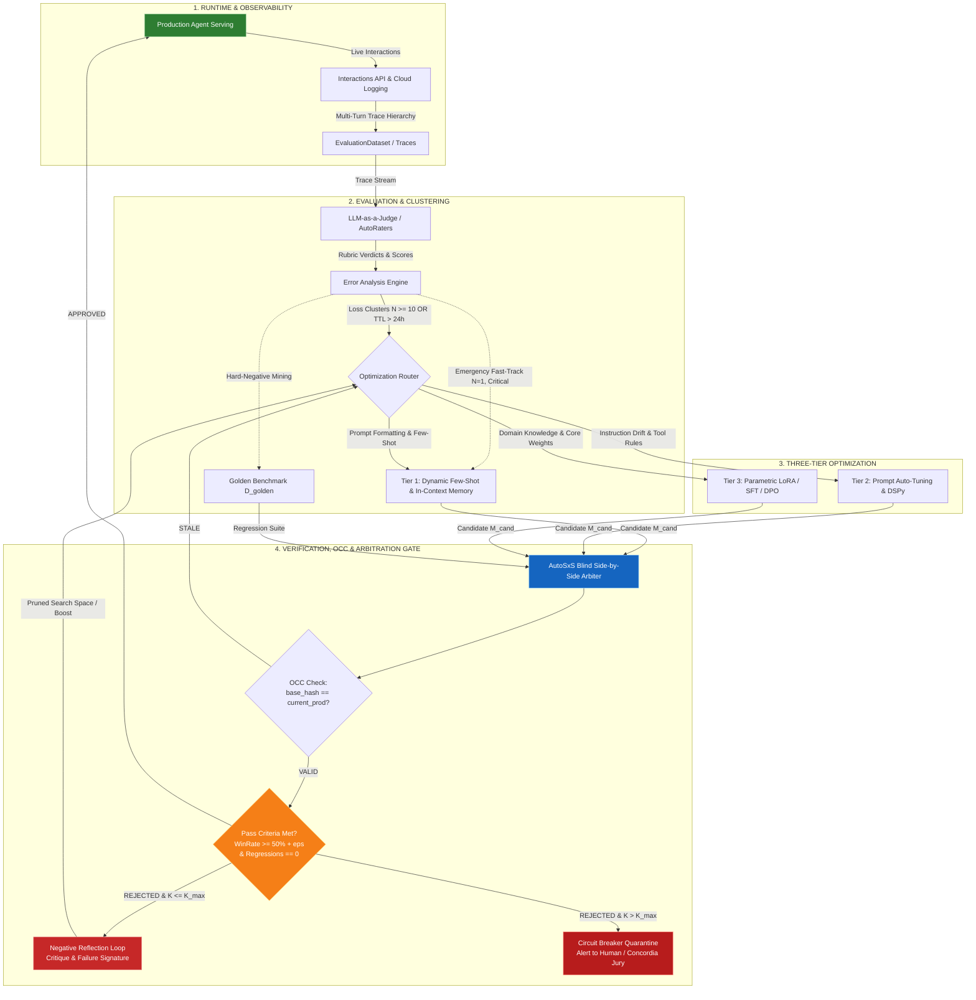

# Continuous Agent Self-Improvement Flywheel Architecture

## 📌 Core Architecture Summary

**Continuous Agent Self-Improvement Flywheel** — это замкнутая кибернетическая система автономного повышения качества рассуждений, планирования и использования инструментов субагентами Vazus SuperGraph OS. 

В отличие от традиционных открытых циклов (где логирование не связано с автоматической генерацией правок, а новые промпты развертываются без строгой проверки на регрессии), данная архитектура гарантирует **математическую замкнутость всех пяти контуров обратной связи**:
1. Любая сессия выполнения оставляет структурированный неизменяемый мультитурный след (`AgentData` $\to$ `ConversationTurn` $\to$ `AgentEvent`).
2. Каждая траектория автоматически валидируется через предиктивные AutoRaters и формальные контракты.
3. Ошибки агрегируются в L1/L2 таксономические кластеры с пороговой активацией оптимизаторов (Batch $N \ge 10$, Emergency Fast-Track $N = 1$ для критических сбоев, Aging Flush $\text{TTL} > 24\text{h}$).
4. Оптимизация разделена на 3 диапазона скоростей: Fast (In-Context Few-Shot / DPO пары), Warm (Prompt Auto-Tuning / DSPy), Cold (LoRA / SFT параметрическая адаптация).
5. Ни одна мутация не попадает в рантайм без победы в слепом двойном арбитраже `AutoSxS`, нулевой регрессии на $\mathcal{D}_{golden}$ и проверки версии базового промпта (OCC Rebase). При отклонении критика возвращается в оптимизатор, а при превышении порога $K > K_{\max}$ активируется Circuit Breaker изоляция.



---

## 🗺️ Структура Дерева Знаний Flywheel

Дерево заметок в базе знаний Vazus спроектировано иерархически:

```text
[[Zettel_Continuous_Agent_Self_Improvement_Flywheel]] (Корневой Хаб)
├── [[ADR_005_CONTINUOUS_AGENT_SELF_IMPROVEMENT_FLYWHEEL]] (Архитектурное Решение)
├── [[Zettel_Multi_Turn_Session_Event_Tracing]] (Стадия 1: Трассировка и Сбор)
├── [[Zettel_Autonomous_Trajectory_Evaluation_AutoRaters]] (Стадия 2: Авто-Оценка и Рубрики)
├── [[Zettel_Error_Analysis_Loss_Taxonomy_Clustering]] (Стадия 3: Кластеризация и L1/L2 Таксономия)
├── [[Zettel_Three_Tier_Agent_Optimization_Hierarchy]] (Стадия 4: Хаб Оптимизации)
│   ├── [[Zettel_Dynamic_Few_Shot_In_Context_Learning]] (Tier 1: Быстрая память и DPO пары)
│   ├── [[Zettel_Automated_Prompt_Tuning_and_DSPy_Evolution]] (Tier 2: Мутация инструкций)
│   └── [[Zettel_Parametric_Fine_Tuning_LoRA_SFT_DPO]] (Tier 3: Весовая адаптация LoRA/SFT)
├── [[Zettel_AutoSxS_Blind_Arbitration_and_Regression_Gate]] (Стадия 5: Арбитраж, OCC и A/B Защита)
├── [[Zettel_Closed_Feedback_Loop_Formal_Verification]] (Математические Инварианты Замкнутости)
└── [[agent_eval_quality_flywheel]] (Холст: [[agent_eval_quality_flywheel.canvas]])
```

---

## 🔄 5 Стадий Непрерывного Цикла

### 1. Multi-Turn Session Event Tracing
Сессии сохраняются не плоским текстом, а в виде строго типизированных графов событий:
* Клиентский SDK: `agentplatform.types.evals.AgentData`
* Шаг диалога: `ConversationTurn(turn_index, events=[...])`
* Атомарное действие: `AgentEvent(author, content, parts, thought, tool_call, tool_response)`
* Детализация: [[Zettel_Multi_Turn_Session_Event_Tracing]]

### 2. Autonomous Trajectory Evaluation (AutoRaters)
Автоматическое многоаспектное оценивание без ручной разметки:
* Рубрики качества траектории: `multi_turn_trajectory_quality`, `multi_turn_task_success`
* Рубрики работы с инструментами: `multi_turn_tool_use_quality`
* Рубрики фактологии: `grounding`, `hallucination`
* Детализация: [[Zettel_Autonomous_Trajectory_Evaluation_AutoRaters]]

### 3. Error Analysis & Loss Taxonomy Clustering
Автоматическая кластеризация через `client.evals.generate_loss_clusters`:
* Двухуровневая таксономия (L1: Категория сбоя, L2: Механизм деградации).
* Выявление паттернов сбоя среди сотен сессий.
* Формирование оптимизационного тикета при $\ge 10$ случаях.
* Детализация: [[Zettel_Error_Analysis_Loss_Taxonomy_Clustering]]

### 4. 3-Tier Optimization Hierarchy
Адаптивная диспетчеризация мутаций в зависимости от характера ошибки:
* **Tier 1 (< 50 мс)**: Подгрузка антипримеров и золотых демонстраций в системный промпт через векторный поиск SuperGraph (768D).
* **Tier 2 (5–15 мин)**: Эволюционная мутация системных промптов через алгоритмы типа DSPy MIPRO / GEval.
* **Tier 3 (1–4 часа)**: LoRA/PEFT дообучение весов базовой модели в Google Cloud Vertex AI / Agent Platform.
* Детализация: [[Zettel_Three_Tier_Agent_Optimization_Hierarchy]]

### 5. AutoSxS Blind Arbitration & Regression Gate
Гейт верификации перед релизом:
* Слепое A/B сравнение кандидата с текущей версией.
* Устранение предвзятости (позиционный сдвиг) двойным прогоном со сменой порядка кандидатов.
* Полный регрессионный прогон по неизменяемому датасету $\mathcal{D}_{golden}$.
* Детализация: [[Zettel_AutoSxS_Blind_Arbitration_and_Regression_Gate]]

---

## 🔒 Анализ Замкнутости Контуров (Closed-Loop Invariants)

| Контур | Типичная уязвимость разомкнутых систем | Механизм замыкания в Vazus SuperGraph |
|---|---|---|
| **Forward Feedback** | Ошибка залогирована, но игнорируется | Тройной триггер: Emergency ($N=1$ для safety/security), Batch ($N \ge 10$) и Aging Flush ($\text{TTL} > 24\text{h}$) |
| **Activation Gate** | Мутация сразу деплоится и ломает другие функции | Строгий гейт AutoSxS: $\text{WinRate} \ge 0.55 \land \text{Regressions} = 0 \land \text{OCC}(\text{base\_hash})$ |
| **Negative Reflection** | Неудачная мутация удаляется в никуда; генератор зацикливается | Вердикт рубрики компилируется в `CritiquePayload`, а при $K > K_{\max}$ срабатывает Circuit Breaker Quarantine |
| **Benchmark Drift** | Старый бенчмарк не знает новых типов сбоев | Hard-negative майнинг: каждый новый L1/L2 кластер синтезирует `EvalCase` в $\mathcal{D}_{golden}$ |
| **Trace Provenance** | Обновленный агент теряет привязку к метрикам | Каждый вызов содержит `version_id`, `trace_id`, `prompt_hash` для сквозного аудита |
| **Concurrency Split** | Параллельные оптимизации перетирают чужие правки | OCC проверка хэша базового промпта: при конфликте версий кандидат ребейзится и тестируется заново |

Формальные математические доказательства и SMT Z3 инварианты представлены в [[Zettel_Closed_Feedback_Loop_Formal_Verification]].

---

## 🔗 Related Notes & Wikilinks

- [[ADR_005_CONTINUOUS_AGENT_SELF_IMPROVEMENT_FLYWHEEL]]
- [[Zettel_Multi_Turn_Session_Event_Tracing]]
- [[Zettel_Autonomous_Trajectory_Evaluation_AutoRaters]]
- [[Zettel_Error_Analysis_Loss_Taxonomy_Clustering]]
- [[Zettel_Three_Tier_Agent_Optimization_Hierarchy]]
- [[Zettel_Dynamic_Few_Shot_In_Context_Learning]]
- [[Zettel_Automated_Prompt_Tuning_and_DSPy_Evolution]]
- [[Zettel_Parametric_Fine_Tuning_LoRA_SFT_DPO]]
- [[Zettel_AutoSxS_Blind_Arbitration_and_Regression_Gate]]
- [[Zettel_Closed_Feedback_Loop_Formal_Verification]]
- [[ADR_004_CODE_INTELLIGENCE_5LAYERS]]
- [[Zettel_Recursive_Self_Improvement_Combat_Run_2026]]
- [[Zettel_MAGMA_Pattern_Mining_and_Routing]]
