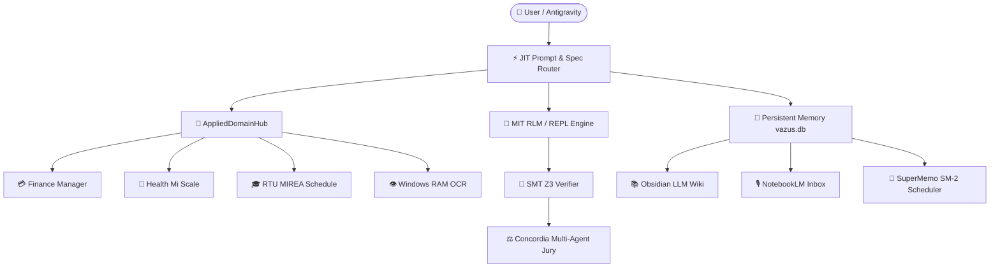

# 🗺️ Zettel: Dialogue Synthesis & Architectural Roadmap

**Type**: #architectural_roadmap #dialogue_synthesis #chelpanov_logic
**Last Synchronized**: 2026-08-21 01:12:26

## 📌 Core Dialogue Directives & System Invariants

| Domain | Topic | Core Specification | Active Recall Status |
| :--- | :--- | :--- | :--- |
| `architecture` | **Autonomous Cognitive Engine** | Antigravity is the autonomous operating system itself, equipped with Hermes dispatch, SMT Z3 solvers, AST token pruning, and lifecycle hooks. | 🟢 SM-2 Card Scheduled |
| `cognitive` | **Formal Logic & Cognitive Laws (Chelpanov)** | Application of Chelpanov's formal logic: eradication of script graveyard, zero-mock empirical verification, AST pruning (Law of Inverse Relation), and anti-loop circuit breakers. | 🟢 SM-2 Card Scheduled |
| `applied_domains` | **Applied Domain Hub** | Single unified facade AppliedDomainHub aggregates Tinkoff/NPD finance, Mi Scale BIA health, RTU MIREA schedule, RAM clipboard OCR, and Obsidian Daily Briefing in <= 10 ms. | 🟢 SM-2 Card Scheduled |
| `knowledge` | **Knowledge Ingestion & NotebookLM** | Two-layer knowledge pipeline: NotebookLM for audio podcasts and macro-synthesis, Obsidian + SuperMemo SM-2 for atomic Zettelkasten and active recall. | 🟢 SM-2 Card Scheduled |
| `verification` | **Test Isolation & Zero-Leak Invariant** | All test suites in tests/ use isolated tmp_path SQLite fixtures, guaranteeing zero side-effects and byte-identical SHA256 on production services/memory/vazus.db. | 🟢 SM-2 Card Scheduled |
| `engine` | **MIT RLM & Recursive REPL** | MIT RLM (Recursive Language Modeling) with AngelicHoleSolver localizes code holes and synthesizes formal patches in isolated LocalREPL with convergence in <= 1.4 iterations. | 🟢 SM-2 Card Scheduled |

## 🌐 System-Wide Subsystem Flowchart

## 🔗 Related Knowledge Nodes
- [[Zettel_Логика_Георгий_Челпанов_Master_Guide]]
- [[Zettel_О_памяти_и_мнемонике_Георгий_Челпанов]]
- [[Zettel_Skill_Tree_Dashboard]]
- [[Zettel_Daily_Briefing_2026-08-20]]
