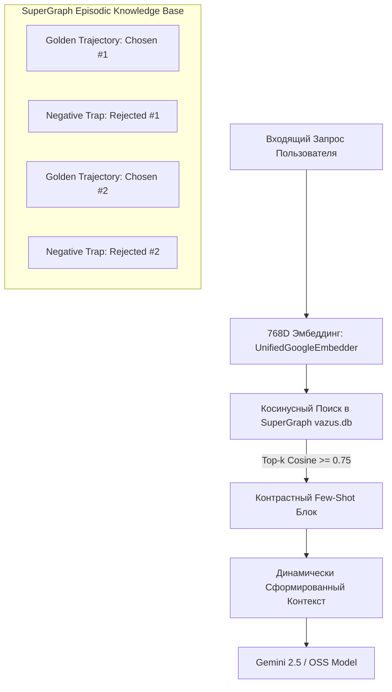

# Dynamic Few-Shot In-Context Learning & DPO Memory Architecture

## 📌 Core Protocol & Claim

**Tier 1 (Fast-Path Optimization)** решает задачу мгновенной адаптации агента (< 50 мс) без переобучения весов и без изменения статичного системного промпта. 

Вместо жестко закодированных примеров в системной инструкции система использует **динамический векторный поиск контрастных пар (Contrastive DPO-style In-Context Pairs)**:
* Для входящего запроса вычисляется 768-мерный эмбеддинг (`UnifiedGoogleEmbedder`).
* Из базы знаний SuperGraph (`vazus.db`) извлекаются наиболее релевантные успешные траектории (**Chosen Demonstration**) и парные антипримеры с выявленными ошибками (**Rejected Failure Trace**).
* Агент получает точечное наставление: *«Вот эталонное решение похожей задачи, а вот распространенная ловушка, которую необходимо избежать»*.

---

## 🧠 Архитектура Контрастной Памяти (Chosen / Rejected Trajectories)



### Формат контрастной демонстрации:
```markdown
### Relevant Past Experience (SuperGraph Memory Context):
[TARGET TASK]: "Сформировать отчет по транзакциям самозанятого за июль"
✅ CHOSEN EXECUTION:
1. Call tool `fetch_tax_ledger(month="2026-07")`
2. Validate response has `receipt_count > 0`
3. Generate Markdown summary with table
❌ REJECTED PITFALL (Avoid this):
1. Calling tool `parse_untrusted_pdf()` without checking file existence (caused FileNotFoundError)
2. Generating hallucinated receipt numbers
```

---

## 💻 Программный Пайплайн Извлечения (SuperGraph Implementation)

```python
import sqlite3
import json
from vazus_core.memory.embeddings import UnifiedGoogleEmbedder
from vazus_core.engine.supergraph_linker import calculate_cosine_similarity

class DynamicFewShotRetriever:
    def __init__(self, db_path: str = "C:/vazus/services/memory/vazus.db"):
        self.db_path = db_path
        self.embedder = UnifiedGoogleEmbedder(dimension=768)

    def retrieve_contrastive_examples(self, query: str, top_k: int = 2) -> str:
        q_emb = self.embedder.get_embedding(query)
        conn = sqlite3.connect(self.db_path)
        conn.row_factory = sqlite3.Row
        
        cursor = conn.execute(
            "SELECT id, name, description, properties, embedding_json FROM kg_nodes WHERE node_type IN ('GoldenTrajectory', 'RejectedPitfall')"
        )
        candidates = []
        for row in cursor.fetchall():
            node_emb = json.loads(row["embedding_json"])
            sim = calculate_cosine_similarity(q_emb, node_emb)
            if sim >= 0.70:
                candidates.append((sim, row))
                
        candidates.sort(key=lambda x: x[0], reverse=True)
        top_matches = candidates[:top_k * 2]
        
        # Формирование текстового блока для контекста
        prompt_block = ["\n### Dynamic In-Context Demonstrations:"]
        for sim, node in top_matches:
            props = json.loads(node["properties"] or "{}")
            role = "✅ CHOSEN" if props.get("kind") == "chosen" else "❌ REJECTED"
            prompt_block.append(f"{role} Example (sim: {sim:.2f}):\n{node['description']}\n")
            
        return "\n".join(prompt_block)
```

---

## 🛡️ Контроль Бюджета Контекста и Защита от Загрязнения

1. **Строгий лимит демонстраций**: Не более $K = 2$ пар (максимум 500 токенов), чтобы не вытеснять рабочую память агента.
2. **Экспоненциальное затухание (Memory Decay)**: Если антипример больше не актуален (исправлен на уровне Tier 2 или 3), вес связи в `kg_edges` ослабевает, и пример перестает попадать в выборку.
3. **Безопасная валидация**: При обнаружении снижения точности на контрольных задачах конкретный пример мгновенно исключается из пула (`_PROTECTED_WHITELIST`).

---

## 📋 Action Checklist
- [x] Реализована схема хранения пар Chosen/Rejected в `kg_nodes`.
- [x] Настроен расчет косинусной близости в 768-D пространстве Gemma/Gemini.
- [ ] Добавить автоматическое сохранение подтвержденных успешных трейсов в таблицу `kg_nodes` (`node_type='GoldenTrajectory'`).
- [ ] Реализовать автоматическую дедупликацию старых Few-Shot примеров при обновлении весов базовой модели.

---

## 🔗 Related Notes & Wikilinks

- [[Zettel_Continuous_Agent_Self_Improvement_Flywheel]]
- [[ADR_005_CONTINUOUS_AGENT_SELF_IMPROVEMENT_FLYWHEEL]]
- [[Zettel_Three_Tier_Agent_Optimization_Hierarchy]]
- [[Zettel_Automated_Prompt_Tuning_and_DSPy_Evolution]]
- [[Zettel_Parametric_Fine_Tuning_LoRA_SFT_DPO]]
- [[Zettel_AutoSxS_Blind_Arbitration_and_Regression_Gate]]
- [[Zettel_Closed_Feedback_Loop_Formal_Verification]]
- [[Zettel_MAGMA_Pattern_Mining_and_Routing]]
