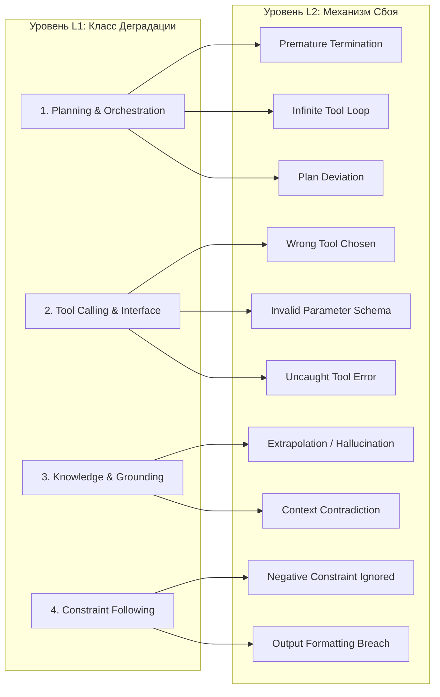

# Error Analysis & Loss Taxonomy Clustering Architecture

## 📌 Core Protocol & Claim

Чтение сотен разрозненных трейсов сбоев вручную создает непреодолимый шум и не позволяет масштабировать процесс самоулучшения агентов. Для эффективной оптимизации необходима **семантическая кластеризация потерь и ошибок (Loss Clustering)** с привязкой к иерархической двухуровневой таксономии (L1/L2).

В сервисе Error Analysis платформы Agent Platform сбои метрик `multi_turn_task_success` и `multi_turn_tool_use_quality` автоматически группируются в смысловые кластеры с расчетом частоты, генерацией описания механизма сбоя и репрезентативных примеров.

---

## 🗂️ Иерархическая Таксономия Ошибок (L1/L2)



### Спецификация категорий таксономии:
1. **Planning & Orchestration (L1)**:
   * `Premature Termination (L2)`: Агент объявляет задачу завершенной до фактического получения результата от инструмента.
   * `Infinite Tool Loop (L2)`: Повторные однотипные вызовы с одинаковыми неверными аргументами без смены стратегии.
   * `Plan Deviation (L2)`: Агент сформулировал в `thought` корректный план, но сделал противоположное действие.
2. **Tool Calling & Interface (L1)**:
   * `Wrong Tool Chosen (L2)`: Семантическое несоответствие между целью шага и описанием инструмента в схеме.
   * `Invalid Parameter Schema (L2)`: Галлюцинация обязательных аргументов или передача неверного типа (str вместо int).
   * `Uncaught Tool Error (L2)`: Игнорирование ошибки рантайма (e.g. `404 Not Found`) и продолжение работы с пустым ответом.
3. **Knowledge & Grounding (L1)**:
   * `Extrapolation (L2)`: Добавление фактов, отсутствующих в выходе инструментов или контексте.
   * `Context Contradiction (L2)`: Прямое логическое противоречие системной инструкции или данным из памяти.
4. **Constraint Following (L1)**:
   * `Negative Constraint Ignored (L2)`: Нарушение запретов типа «НЕ вызывай bash», «НЕ используй wildcard».

---

## 💻 Программный Пайплайн Кластеризации (SDK Snippet)

```python
import agentplatform

def analyze_and_cluster_failures(eval_result, project_id: str, cluster_age_hours: float = 0.0):
    # Error Analysis сервис исполняется в глобальном регионе
    client = agentplatform.Client(project=project_id, location="global")

    # Запуск кластеризации сбоев по метрике успешности
    response = client.evals.generate_loss_clusters(
        eval_result=eval_result,
        metric="multi_turn_task_success",
        config={"max_top_cluster_count": 5}
    )

    actionable_clusters = []
    for r in response.results:
        for cluster in r.clusters:
            entry = cluster.taxonomy_entry
            is_critical = entry.l1_category in ("Safety", "Security") or entry.l2_category == "Uncaught Tool Error"
            
            # Многоприоритетная активация:
            # 1. Emergency Fast-Track: N = 1 для критических сбоев
            # 2. Standard Batch: N >= 10
            # 3. Aging TTL Flush: N >= 3 при возрасте кластера > 24 часов
            trigger_opt = False
            priority = "NORMAL"
            if is_critical and cluster.item_count >= 1:
                trigger_opt = True
                priority = "EMERGENCY_FAST_TRACK"
            elif cluster.item_count >= 10:
                trigger_opt = True
                priority = "BATCH_STANDARD"
            elif cluster.item_count >= 3 and cluster_age_hours >= 24.0:
                trigger_opt = True
                priority = "AGING_TTL_FLUSH"

            cluster_info = {
                "l1": entry.l1_category,
                "l2": entry.l2_category,
                "description": entry.description,
                "count": cluster.item_count,
                "sample_case_ids": cluster.sample_case_ids,
                "trigger_optimization": trigger_opt,
                "dispatch_priority": priority
            }
            actionable_clusters.append(cluster_info)

    return actionable_clusters
```

---

## 🔄 Замыкание Контура: Многоприоритетная Диспетчеризация и Пополнение Бенчмарка

1. **Многоприоритетная Авто-Маршрутизация (Stage 4)**:
   * **Emergency Fast-Track ($N=1$, Critical)**: Критические уязвимости, нарушение политик безопасности (`Safety Breach`) и аварийные сбои рантайма немедленно инжектируются в **Tier 1 (In-Context Memory)** как Rejected-демонстрация без ожидания батча.
   * **Ошибки форматирования и запретов (`Constraint Following`)** $\to$ **Tier 1 (In-Context / Few-Shot)**.
   * **Ошибки выбора инструментов и планирования (`Planning`, `Tool Calling`)** $\to$ **Tier 2 (Prompt Auto-Tuning)**.
   * **Системные сбои рассуждений и специфический синтаксис** $\to$ **Tier 3 (LoRA / SFT)**.
   * **Aging TTL Flush**: Кластеры с $3 \le N < 10$ сбрасываются в Tier 1 через 24 часа, гарантируя отсутствие «зависших» в буфере ошибок.
2. **Hard-Negative Mining (Пополнение Golden Benchmark)**:
   * Репрезентативные кейсы из каждого нового кластера автоматически преобразуются в эталонные сценарии `EvalCase` и навсегда вносятся в неизменяемый контрольный датасет $\mathcal{D}_{golden}$, предотвращая регрессии в будущих релизах.

---

## 📋 Action Checklist
- [x] Определена строгая двухуровневая таксономия потерь L1/L2.
- [x] Установлен многоприоритетный протокол диспетчеризации (Emergency $N=1$, Batch $N \ge 10$, Aging TTL $24\text{h}$).
- [ ] Настроить регулярную фоновую кластеризацию суточных сессий через Cloud Scheduler.
- [ ] Добавить экспорт кластерных дашбордов в формате HTML (`scripts/render_html_report.py`).

---

## 🔗 Related Notes & Wikilinks

- [[Zettel_Continuous_Agent_Self_Improvement_Flywheel]]
- [[ADR_005_CONTINUOUS_AGENT_SELF_IMPROVEMENT_FLYWHEEL]]
- [[Zettel_Autonomous_Trajectory_Evaluation_AutoRaters]]
- [[Zettel_Three_Tier_Agent_Optimization_Hierarchy]]
- [[Zettel_AutoSxS_Blind_Arbitration_and_Regression_Gate]]
- [[Zettel_Closed_Feedback_Loop_Formal_Verification]]
- [[Zettel_Dynamic_Few_Shot_In_Context_Learning]]
- [[Zettel_Automated_Prompt_Tuning_and_DSPy_Evolution]]
- [[Zettel_Parametric_Fine_Tuning_LoRA_SFT_DPO]]
