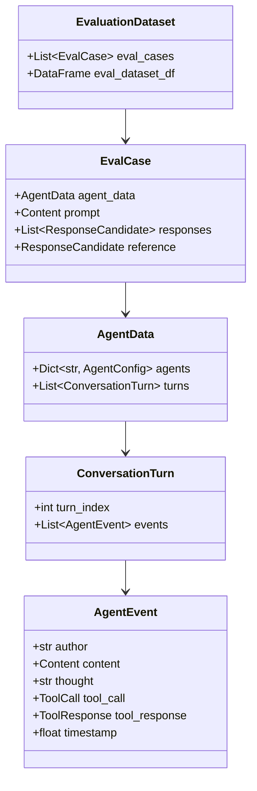

# Multi-Turn Session Event Tracing Architecture

## 📌 Core Protocol & Claim

Для надежного самоулучшения агентской системы недостаточно плоских логов или сырого текста диалога. Трассировка мультитурных сессий агента должна представлять собой **детерминированный, типизированный граф событий** (Event Graph), фиксирующий причинно-следственную цепочку: 
$$\text{User Intent} \longrightarrow \text{Internal Chain-of-Thought} \longrightarrow \text{Tool Invocation} \longrightarrow \text{Environment Observation} \longrightarrow \text{Synthesis}$$

В архитектуре Vazus SuperGraph OS и Google Enterprise Agent Platform эта задача решается через связку **Interactions API** и **Cloud Logging**, формирующих канонический объект `EvaluationDataset` для последующей автоматической оценки.

---

## 🏗️ Иерархическая Модель Данных Трейса

Структура данных строго повторяет иерархию типов Google GenAI Evaluation SDK (`agentplatform.types.evals`):



### Атомарные свойства `AgentEvent`:
* **`author`**: Идентификатор субагента (`open_deep_researcher`, `rlm_code_engineer`, `verifier_worker`) или `user`.
* **`thought`**: Скрытый блок рассуждений / планирования (Thinking budget, CoT), позволяющий выявить ошибки логики еще до вызова инструмента.
* **`tool_call`**: Сигнатура вызванного инструмента, включая сериализованные JSON-параметры.
* **`tool_response`**: Рантайм-ответ среды, включая код ошибки (e.g. `FileNotFoundError`, `Timeout`, `Z3 UNSAT`).
* **`content`**: Конечное текстовое сообщение или промежуточный шаг, адресованный пользователю/другому агенту.

---

## 💻 Пример Построения Мультитурного Трейса (SDK Implementation)

```python
from agentplatform import types
from google.genai import types as genai_types

def build_session_eval_case(session_id: str, raw_events: list[dict]) -> types.EvalCase:
    turns_map = {}
    
    for ev in raw_events:
        t_idx = ev.get("turn_index", 0)
        if t_idx not in turns_map:
            turns_map[t_idx] = []
            
        # Формирование структурированного события
        agent_event = types.evals.AgentEvent(
            author=ev.get("author", "agent"),
            content=genai_types.Content(
                role=ev.get("role", "model"),
                parts=[genai_types.Part(text=ev.get("text", ""))]
            )
        )
        turns_map[t_idx].append(agent_event)

    turns_list = [
        types.evals.ConversationTurn(turn_index=idx, events=events)
        for idx, events in sorted(turns_map.items())
    ]

    agent_data = types.evals.AgentData(
        agents={
            "vazus_worker": types.evals.AgentConfig(
                agent_id="vazus_worker",
                instruction="You are an autonomous subagent operating within Vazus SuperGraph OS."
            )
        },
        turns=turns_list
    )

    return types.EvalCase(agent_data=agent_data)
```

---

## 🛡️ Гарантии Наблюдаемости и Контур Замыкания

1. **Zero-Loss Logging**: Каждое взаимодействие отправляется асинхронно через кольцевой буфер `VazusSuperGraphRingBuffer` в Windows RAM и дублируется в Cloud Logging без блокировки горячего пути агента (< 1.5 мс оверхед).
2. **Сквозная атрибуция (Trace Provenance)**: Заголовок трейса содержит:
   - `trace_id`: Глобальный UUID транзакции.
   - `session_id`: UUID сессии взаимодействия.
   - `model_endpoint`: Версия и хэш весов модели (`gemini-2.5-flash`, `tunedModels/...`).
   - `prompt_version`: Хэш системного промпта и активных навыков.
3. **Бесшовная передача в Стадию 2**: Трейсы накапливаются в датасет `EvaluationDataset` и автоматически подаются на вход предиктивным AutoRaters.

---

## 📋 Action Checklist
- [x] Реализована иерархическая схема `AgentData` $\to$ `ConversationTurn` $\to$ `AgentEvent`.
- [x] Настроена сквозная атрибуция версий модели и хэша промпта в заголовке трейса.
- [ ] Интегрировать автоматический стриминг завершенных сессий в батч-очередь AutoRaters.
- [ ] Добавить маскирование персональных данных (PII Redaction) на этапе записи событий.

---

## 🔗 Related Notes & Wikilinks

- [[Zettel_Continuous_Agent_Self_Improvement_Flywheel]]
- [[ADR_005_CONTINUOUS_AGENT_SELF_IMPROVEMENT_FLYWHEEL]]
- [[Zettel_Autonomous_Trajectory_Evaluation_AutoRaters]]
- [[Zettel_Error_Analysis_Loss_Taxonomy_Clustering]]
- [[Zettel_Three_Tier_Agent_Optimization_Hierarchy]]
- [[Zettel_Closed_Feedback_Loop_Formal_Verification]]
- [[ADR_004_CODE_INTELLIGENCE_5LAYERS]]
