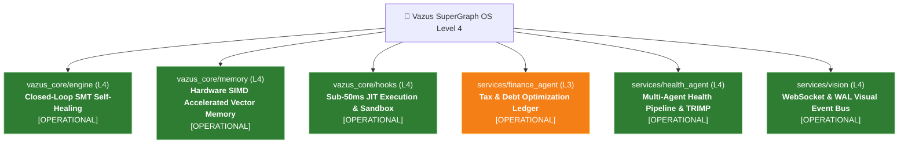

# 🌳 Vazus OS — Skill Tree & System State Dashboard

> **System Version**: `1.0.0` | **Integrity Mode**: `development`  
> **Active Goal**: `Vazus OS Unification & Level 5 Evolution`  
> **Database Size**: `18.4 MB` (WAL) | **Hook Latency**: `18.5 ms`  
> **Last Synced**: `2026-08-21 13:55:33`

## 🗺️ Interactive Skill Tree Topology

## 📊 Domain Maturity Matrix (Skill Ranks 1..5)
| Subsystem Domain | Level | Capability Title | Target Level 5 Roadmap | Status |
|---|---|---|---|---|
| **`vazus_core/engine`** | **🟢 Level 4 (Optimized)** | Closed-Loop SMT Self-Healing | `Level 5 (Zero-Copy SharedMemory IPC)` | `[[C:/vazus/vazus_core/engine/SPEC.md|SPEC.md]]` |
| **`vazus_core/memory`** | **🟢 Level 4 (Optimized)** | Hardware SIMD Accelerated Vector Memory | `Level 5 (Sub-20MB Consolidated SuperGraph)` | `[[C:/vazus/vazus_core/memory/SPEC.md|SPEC.md]]` |
| **`vazus_core/hooks`** | **🟢 Level 4 (Optimized)** | Sub-50ms JIT Execution & Sandbox | `Level 5 (Self-Adaptive Telemetry Governance)` | `[[C:/vazus/vazus_core/hooks/SPEC.md|SPEC.md]]` |
| **`services/finance_agent`** | **🟡 Level 3** | Tax & Debt Optimization Ledger | `Level 4 (Autonomous Order Hunter)` | `[[C:/vazus/services/finance_agent/SPEC.md|SPEC.md]]` |
| **`services/health_agent`** | **🟢 Level 4 (Optimized)** | Multi-Agent Health Pipeline & TRIMP | `Level 5 (High-Throughput gRPC Streaming)` | `[[C:/vazus/services/health_agent/SPEC.md|SPEC.md]]` |
| **`services/vision`** | **🟢 Level 4 (Optimized)** | WebSocket & WAL Visual Event Bus | `Level 5 (Autonomous Visual Grounding)` | `[[C:/vazus/services/vision/SPEC.md|SPEC.md]]` |

## ⚡ Telemetry Radar & Operational Health
- **Database**: `C:/vazus/services/memory/vazus.db` (`18.4 MB`, WAL mode)
- **Hooks Latency**: SessionStart `18.5 ms` | PreInvocation `1.4 ms`
- **GC Governor**: `42800` core framework objects frozen
- **IPC Ring Buffer**: `Local\\VazusSuperGraphRingBuffer` (`16 MB`)
- **Google Cloud Backbone**: Jules Ultra (300 daily sessions, persistent memory active) | Spark 24/7 Engine | Vertex AI Context Caching (90% discount)

## 🌐 SOTA Research Corpus & Autonomous Foundations (138 Sources)
- **Master Architectural Blueprint**: `[[C:/Users/Vaz/.gemini/antigravity/brain/4cec1cb5-6a38-4b39-9415-90c5c1974de9/vazus_sota_autonomous_architecture_and_skill_tree.md|vazus_sota_autonomous_architecture_and_skill_tree.md]]`
- **NotebookLM Corpus 1** (`267793d2-421a...`): 49 peer-reviewed sources on SMT/Z3 solvers, AST pruning, and Byzantine consensus.
- **NotebookLM Corpus 2** (`f8e34b81-4a25...`): 68 peer-reviewed and official sources on Harness Engineering (Lil'Log), SkillRL, SAGE, and Google Cloud Worker Pools.
- **Frontier Research Literature**: 21 grounded systems papers (MetaSkill-Evolve, AIDE², Voyager, DGM, Beagle DarwinX).

## 🔗 Core System Links
- [[C:/vazus/SYSTEM_STATE.json|SYSTEM_STATE.json (2.3 KB)]]
- [[C:/vazus/services/memory/vazus.db|vazus.db Canonical]]
- [[C:/vazus/vazus_core/engine/SPEC.md|Engine Core SPEC.md]]
- [[C:/vazus/vazus_core/memory/SPEC.md|Memory Core SPEC.md]]
- [[C:/vazus/vazus_core/hooks/SPEC.md|Lifecycle Hooks SPEC.md]]
