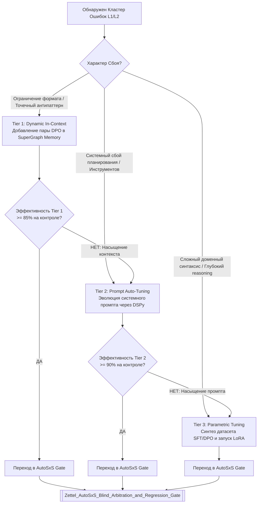

# Three-Tier Agent Optimization Hierarchy Architecture

## 📌 Core Protocol & Claim

Попытка решать все проблемы агента одним методом приводит к неэффективности: постоянное дообучение весов (LoRA/SFT) слишком дорого и медленно для оперативных фиксов, а раздувание системного промпта приводит к деградации внимания и исчерпанию контекстного окна.

Архитектура Vazus SuperGraph OS реализует **3-уровневую адаптивную иерархию оптимизации (3-Tier Optimization Hierarchy)**, разделяющую пространство мутаций по скорости реакции, стоимости и глубине воздействия:
* **Tier 1 (Fast-Path / In-Context)**: Динамический подбор Few-Shot примеров, пар DPO и негативных правил через 768D векторную память.
* **Tier 2 (Warm-Path / Prompt Auto-Tuning)**: Эволюционная мутация системных инструкций и спецификаций инструментов (DSPy, GEval).
* **Tier 3 (Cold-Path / Parametric Adaptation)**: Дообучение весов модели через LoRA, SFT и DPO в облачной среде Vertex AI.

---

## ⚖️ Сравнительная Матрица Уровней Оптимизации

| Параметр | Tier 1: In-Context Fast-Path | Tier 2: Prompt Auto-Tuning | Tier 3: Parametric LoRA / SFT |
|---|---|---|---|
| **Время реакции** | **< 50 мс** (JIT injection) | **5 – 15 минут** (локальный поиск) | **1 – 4 часа** (облачный кластер) |
| **Стоимость (Compute)** | $0$ (индексированный поиск) | Низкая (несколько LLM вызовов) | Высокая (GPU/TPU квота) |
| **Точка мутации** | Рабочий контекст / Memory Wiki | Системный промпт / Tool Schema | Веса матрицы внимания / LoRA адаптер |
| **Глубина адаптации** | Поверхностные правила, антипримеры | Стратегия планирования, логика вызовов | Глубокий reasoning, DSL синтаксис |
| **Устойчивость к дрейфу** | Высокая (легко очистить/заменить) | Средняя (требует версионирования) | Абсолютная (зашито в веса) |
| **Подробная заметка** | [[Zettel_Dynamic_Few_Shot_In_Context_Learning]] | [[Zettel_Automated_Prompt_Tuning_and_DSPy_Evolution]] | [[Zettel_Parametric_Fine_Tuning_LoRA_SFT_DPO]] |

---

## 🎛️ Диспетчер Маршрутизации и Протокол Эскалации

### Правила Эскалации (Escalation Rules):
1. **Saturation Escalation (Tier 1 $\to$ Tier 2)**: Если добавление $\ge 3$ примеров в In-Context память не устраняет ошибку или начинает вытеснять рабочий контекст задачи, тикет эскалируется в Tier 2 для переформулирования базовой инструкции.
2. **Complexity Escalation (Tier 2 $\to$ Tier 3)**: Если длина системного промпта превышает 2000 токенов или после 10 итераций мутации промпта метрика `multi_turn_trajectory_quality` стагнирует ниже 0.80, задача передается в Tier 3 для кристаллизации поведения в веса модели.
3. **Terminal Escalation & Circuit Breaker (Tier 3 $\to$ Quarantine)**: Если дообученная модель (LoRA/SFT) не проходит арбитраж `AutoSxS` после $K_{\max} = 3$ попыток обучения, задача не зацикливается, а помещается в `Quarantine_DeadLetter_Queue` с генерацией отчета для Concordia Multi-Agent Jury и инженера.
4. **OCC Rebase Protocol**: Если во время оптимизации в Tier 2 или Tier 3 в продакшене был активирован другой кандидат (смена `prod_hash`), кандидат обязан выполнить автоматический ребейз на актуальный базовый промпт и пройти повторный прогон на $\mathcal{D}_{golden}$.

---

## 🛡️ Безопасность и Гейтирование Мутаций

Никакая оптимизация из любого уровня **никогда не попадает напрямую в Production-окружение**:
$$\forall k \in \{1, 2, 3\}: \quad \text{Candidate}(\text{Tier}_k) \xrightarrow{\text{STRICT}} \text{AutoSxS Verification Gate} \xrightarrow{\text{PASS ONLY}} \text{Serving}$$
Любой кандидат обязан доказать превосходство над текущим baseline ($\text{WinRate} \ge 0.55$), показать 0 регрессий на $\mathcal{D}_{golden}$ и подтвердить актуальность хэша базового промпта ($\text{OCC}_{\text{valid}}$).

---

## 📋 Action Checklist
- [x] Спроектирован 3-уровневый контур оптимизации с четким разделением ролей.
- [x] Формализованы правила эскалации при насыщении предыдущего уровня.
- [x] Определена терминальная политика изоляции Tier 3 с защитой от бесконечного расхода квот.
- [x] Сформулирован протокол предотвращения конфликтов параллельных мутаций (OCC Rebase).
- [ ] Реализовать автоматический роутер в модуле `vazus_core/evolution/optimization_router.py`.
- [ ] Настроить мониторинг бюджета токенов и стоимости обучения для каждого тира.

---

## 🔗 Related Notes & Wikilinks

- [[Zettel_Continuous_Agent_Self_Improvement_Flywheel]]
- [[ADR_005_CONTINUOUS_AGENT_SELF_IMPROVEMENT_FLYWHEEL]]
- [[Zettel_Error_Analysis_Loss_Taxonomy_Clustering]]
- [[Zettel_Dynamic_Few_Shot_In_Context_Learning]]
- [[Zettel_Automated_Prompt_Tuning_and_DSPy_Evolution]]
- [[Zettel_Parametric_Fine_Tuning_LoRA_SFT_DPO]]
- [[Zettel_AutoSxS_Blind_Arbitration_and_Regression_Gate]]
- [[Zettel_Closed_Feedback_Loop_Formal_Verification]]
