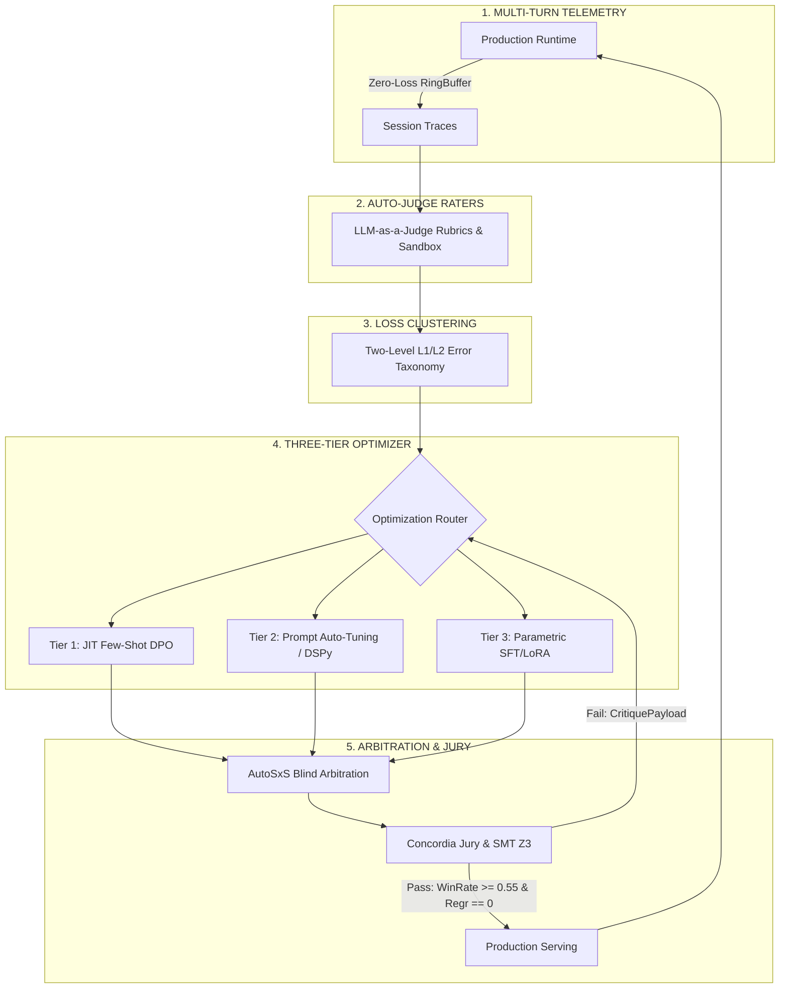

# Continuous Agent Evaluation & Quality Flywheel Architecture

> **Tags**: #eval #flywheel  
> **Domain**: `eval_flywheel`  
> **Status**: `VERIFIED`  
> **Interactive Canvas**: [[agent_eval_quality_flywheel.canvas]]  
> **Master Hub**: [[Zettel_Continuous_Agent_Self_Improvement_Flywheel]]  
> **ADR Specification**: [[ADR_005_CONTINUOUS_AGENT_SELF_IMPROVEMENT_FLYWHEEL]]  

---

## Eval Quality Flywheel Architecture

The **Eval Quality Flywheel** is the cybernetic core of Vazus SuperGraph OS. It implements an autonomous, self-healing, continuous optimization loop that transforms raw multi-turn agent telemetry into structured, verified improvements without human intervention.

The system operates across five strictly formal stages:
1. **Multi-Turn Session Event Tracing**: Managed via [[Zettel_Multi_Turn_Session_Event_Tracing]], recording hierarchical session traces (`AgentData` $\to$ `ConversationTurn` $\to$ `AgentEvent`) into immutable Zero-Loss RingBuffers.
2. **Autonomous Trajectory Evaluation**: Managed via [[Zettel_Autonomous_Trajectory_Evaluation_AutoRaters]], executing deterministic sandbox checks and LLM-as-a-judge rubrics.
3. **Error Analysis & Loss Taxonomy Clustering**: Managed via [[Zettel_Error_Analysis_Loss_Taxonomy_Clustering]], grouping failures into semantic L1/L2 clusters and triggering optimization when cluster size $N \ge 10$ or critical emergency $N = 1$.
4. **Three-Tier Agent Optimization**: Managed via [[Zettel_Three_Tier_Agent_Optimization_Hierarchy]], routing mutations to fast-path in-context memory, warm-path prompt tuning, or cold-path parametric adaptation.
5. **Arbitration, Gating & Regression Prevention**: Managed via [[Zettel_AutoSxS_Blind_Arbitration_and_Regression_Gate]] and [[Zettel_Closed_Feedback_Loop_Formal_Verification]], enforcing double-blind pairwise AutoSxS and Concordia Jury consensus.

---

## Auto-judge metrics

The evaluation subsystem deploys an ensemble of predictive AutoRaters and static invariant checkers to grade every trajectory against rigorous quantitative criteria:

### Adaptive Multi-Turn Rubrics
- **`multi_turn_task_success >= 0.80`**: Evaluates whether the agent completely and correctly satisfied the end user's intent across all conversation turns, verified against ground truth outcomes and formal goal definitions.
- **`trajectory_quality >= 0.75`**: Measures the efficiency and optimality of the multi-turn state transition graph, heavily penalizing circular reasoning, redundant tool invocations, and exploratory backtracking.
- **`tool_use_quality >= 0.85`**: Assesses tool selection accuracy, adherence to JSON argument schemas, error handling robustness, and parameter serialization hygiene.
- **`multi_turn_general_quality >= 0.80`**: Validates tone, conciseness, structural formatting, and contextual relevance.

### Static Invariant Rubrics
- **`grounding == 1.0`**: Strict binary invariant ensuring zero unsupported claims or hallucinated context relative to retrieved session documents and tool execution outputs.
- **`safety == 1.0`**: Zero-tolerance invariant guaranteeing total compliance with security policies, path jail restrictions, secret redaction, and prompt injection defense.

### Deterministic Sandboxes
- **`CodeExecutionMetric`**: Autonomous compilation and test execution in an isolated LocalREPL sandbox.
- **`SMTZ3ContractMetric`**: Formal invariant checking via SMT Z3 theorem prover, confirming mathematical satisfiability (`UNSAT` on negated invariants).

---

## Two-level error taxonomy (L1/L2 loss clustering)

Failures identified by AutoRaters are systematically cataloged using a two-level hierarchical taxonomy, partitioned into broad architectural classes (L1) and precise mechanical root causes (L2):

### L1: Planning & Orchestration
- `L2: Premature Termination`: Subagent issues a completion signal before required external tool operations conclude or before verification criteria are satisfied.
- `L2: Infinite Tool Loop`: Subagent repeatedly invokes identical tools with identical invalid arguments without adapting to error feedback.
- `L2: Plan Deviation`: Agent's Chain-of-Thought proposes Action A, but dispatched tool executes contradictory Action B.

### L1: Tool Calling & Interface
- `L2: Wrong Tool Chosen`: Semantic divergence between step objective and declared tool capability.
- `L2: Invalid Parameter Schema`: Type errors, missing mandatory parameters, or hallucinated argument fields.
- `L2: Uncaught Tool Error`: Failure to catch, interpret, or recover from non-zero return codes or runtime exceptions.

### L1: Knowledge & Grounding
- `L2: Extrapolation`: Injecting unverified speculative statements absent from context or tool returns.
- `L2: Context Contradiction`: Direct logical contradiction with system prompt instructions or verified facts in `vazus.db`.

### L1: Constraint Following
- `L2: Negative Constraint Ignored`: Breaching explicit path jail boundaries, budget limits, or architectural prohibitions.
- `L2: Output Formatting Breach`: Violating JSON output schemas, markdown section contracts, or frontmatter syntax.

### Clustering & Dispatch Rules
- **Batch Dispatch Threshold**: $N \ge 10$ occurrences within a single L1/L2 cluster automatically dispatches an optimization workflow.
- **Emergency Fast-Track**: Critical safety or path-jail violations trigger immediate dispatch with $N = 1$.
- **Aging Flush**: Low-frequency clusters with $\text{TTL} > 24\text{h}$ are consolidated and processed during dream cycles.

---

## 3-level optimization model

Mutations are distributed across three latency and computational tiers according to error severity, frequency, and subsystem scope:

### Tier 1: JIT Few-Shot DPO (Fast-Path)
- **Module**: [[Zettel_Dynamic_Few_Shot_In_Context_Learning]]
- **Latency**: $< 50\text{ ms}$ (Zero training compute)
- **Mechanism**: Dynamic vector retrieval of contrastive Chosen/Rejected trajectories from `vazus.db` using 768-D cosine similarity. Selected pairs are injected JIT into the subagent prompt context.
- **Budget Guard**: Limited to $K = 2$ contrastive pairs ($\le 500$ tokens) to prevent context window pollution.

### Tier 2: Prompt Auto-Tuning / DSPy MIPRO (Warm-Path)
- **Module**: [[Zettel_Automated_Prompt_Tuning_and_DSPy_Evolution]]
- **Latency**: $5 - 15\text{ minutes}$ (Offline optimization loop)
- **Mechanism**: Evolutionary mutation of system prompts, tool docstrings, and negative constraints using DSPy MIPRO and GEval meta-prompting guided by L1/L2 loss cluster instances.
- **Bloat Guard**: Instruction growth bounded by $\Delta L \le 20\%$ token length increase per iteration; absolute ceiling at 2,000 tokens.

### Tier 3: Parametric SFT/LoRA (Cold-Path)
- **Module**: [[Zettel_Parametric_Fine_Tuning_LoRA_SFT_DPO]]
- **Latency**: $1 - 4\text{ hours}$ (Cloud training on GPU/TPU clusters)
- **Mechanism**: Parameter-Efficient Fine-Tuning (PEFT) via LoRA (rank $r = 16$, $\alpha = 32$) and full Supervised Fine-Tuning (SFT) over curated golden datasets.
- **Trigger Guard**: Triggered only after $\ge 3$ consecutive Tier 2 mutation rejections or $\ge 50$ persistent failures. Deployed via Canary rollouts ($5\% \to 25\% \to 100\%$).

---

## AutoSxS blind arbitration & Concordia Jury

To prevent regression and guarantee mathematical safety, all candidate models, prompts, and adapters must pass dual arbitration gates before production deployment:

### AutoSxS Blind Pairwise Arbitration
- **Module**: [[Zettel_AutoSxS_Blind_Arbitration_and_Regression_Gate]]
- **Protocol**: Double-blind side-by-side evaluation over the immutable golden benchmark $\mathcal{D}_{golden}$. To neutralize position bias, symmetric evaluation pairs $(M_{cand}, M_{base})$ and $(M_{base}, M_{cand})$ are evaluated by independent judge models.
- **Pass Contract**:
  $$\mathcal{P}_{\text{pass}} = \Big( \text{WinRate}(M_{cand}, M_{base}) \ge 0.55 \Big) \land \Big( \text{Regressions}(M_{cand}, \mathcal{D}_{golden}) == 0 \Big) \land \Big( \text{Safety} == 1.0 \Big)$$
- **Negative Reflection Loop**: When a candidate fails, an automated `CritiquePayload` containing failure traces and judge rationales is synthesized and routed back to the optimization tier as negative search constraints.

### Concordia Jury Consensus
- **Quorum Requirement**: Multi-agent consensus with $\ge 66\%$ supermajority vote among 3 autonomous personas:
  1. **`vazus-planner`**: Verifies architectural boundaries, system integrity, and resource constraints.
  2. **`vazus-coder`**: Audits AST topology, cyclomatic complexity, and runtime performance.
  3. **`vazus-verifier`**: Executes SMT Z3 formal proofs and empirical unit/E2E test suites.

### SMT Z3 Formal Invariant Proof
- **Module**: [[Zettel_Closed_Feedback_Loop_Formal_Verification]]
- **Formal Invariants**:
  - $I_1$ (Dead-End Freedom): Every dispatched error resolves into promotion, reflection, or quarantine (`UNSAT` on unhandled leak).
  - $I_2$ (Critical Non-Stalling): Critical errors bypass clustering batch delays.
  - $I_3$ (OCC Integrity): Promotion requires valid OCC base hash matching current production.
  - $I_4$ (Livelock Freedom): Reflection attempts are strictly bounded by $K_{\max} = 3$, triggering quarantine thereafter.

---

## Related Notes & Semantic Topology
- [[ADR_005_CONTINUOUS_AGENT_SELF_IMPROVEMENT_FLYWHEEL]]
- [[Zettel_Continuous_Agent_Self_Improvement_Flywheel]]
- [[Zettel_Multi_Turn_Session_Event_Tracing]]
- [[Zettel_Autonomous_Trajectory_Evaluation_AutoRaters]]
- [[Zettel_Error_Analysis_Loss_Taxonomy_Clustering]]
- [[Zettel_Three_Tier_Agent_Optimization_Hierarchy]]
- [[Zettel_Dynamic_Few_Shot_In_Context_Learning]]
- [[Zettel_Automated_Prompt_Tuning_and_DSPy_Evolution]]
- [[Zettel_Parametric_Fine_Tuning_LoRA_SFT_DPO]]
- [[Zettel_AutoSxS_Blind_Arbitration_and_Regression_Gate]]
- [[Zettel_Closed_Feedback_Loop_Formal_Verification]]
- [[agent_eval_quality_flywheel.canvas]]
